# Petrol Pump ERP

An offline-first ERP for petrol pumps: shifts, nozzles and tanks, sales and credit, reconciliation, payroll, bank matching, daily reports, backups and a full audit trail. It runs on the pump's own computer with **no internet connection needed**: no cloud database, no web server exposed to the world, no remote sync.

The project is in the middle of a planned move from a **PySide6 (Qt) desktop app** to an **Electron + React app** on the *same* Python business logic. Both UIs live in this repository so you can see the transition, one screen at a time.

| | Qt app (original) | Electron app (new, the future) |
|---|---|---|
| UI | PySide6 widgets, `app/ui/` | React + TypeScript, `web/` |
| Shell | Qt window | Electron, `desktop/` |
| Talks to the business logic through | direct Python calls | a local FastAPI service, `api/` |
| Business logic, database, permissions, audit log | `app/` | **the same `app/`, unchanged** |
| Network use | none | none (strict CSP, request blocker, build fails on any external URL) |
| Several PCs at one pump | no | yes: one Main PC plus Client PCs over mutual TLS |

---

## Table of contents

- [From PySide6 to Electron](#from-pyside6-to-electron)
- [Screenshots](#screenshots)
- [What the software does](#what-the-software-does)
- [Architecture](#architecture)
- [Run it](#run-it)
- [Tests](#tests)
- [Build installers](#build-installers)
- [Project structure](#project-structure)
- [Security and data integrity](#security-and-data-integrity)
- [Documentation index](#documentation-index)
- [Status and what is next](#status-and-what-is-next)

---

## From PySide6 to Electron

**Why move.** The Qt app works and passed 996 tests, but its screens were slow to start (about 9 s from double-click to window when packaged as one file), hard to change, and could not print or lay out reports the same way on every PC. The owners also wanted several PCs at the pump (cashier, office, owner) working on one database. A web-technology front end in Electron gives identical rendering everywhere, full print control, quick start-up and a path to many screens at once.

**How it was done, safely.**

1. **Reset point first.** Before any migration code, a git tag marked the last known-good Qt state (`reset/pre-js-frontend-2026-10-09`) so the whole move could be rolled back.
2. **Back end untouched.** `app/services`, `app/models`, `app/core`, Alembic migrations, RBAC meaning, the audit log and backup logic were not changed to suit the new UI. The API routers are thin and call the very same service methods the Qt windows call. Money (`Decimal`) crosses the wire as strings so nothing is rounded on the way.
3. **One screen at a time.** The proof phase moved only **Tanks**, with a parity checklist against the Qt tank window, then every other Qt window followed, then screens the Qt app never had (Today, Checks, Close Shift, Daily Report, Credit control, Bank matching, Payroll, Devices).
4. **Offline stays a hard rule.** The Electron shell blocks every non-local request, the page has a strict Content-Security-Policy, and `npm run build` fails if any external URL (CDN, web font, analytics) sneaks into the bundle.
5. **Qt kept working throughout.** The Qt app and its installer stay buildable until the Electron app is accepted at the pump.

**Measured on the proof build** (details in [docs/migration/JS_MIGRATION_REPORT.md](docs/migration/JS_MIGRATION_REPORT.md)):

| | Electron + Python API | Qt (PyInstaller one-file) |
|---|---|---|
| Double-click to first window (median of 5) | **1.9 s** | 9.4 s |
| Idle memory (working set) | 429 MB, 5 processes | 242 MB, 2 processes |
| Installer | 132 MB (417 MB installed) | 111 MB exe |

The new app starts about five times faster and uses more memory and disk. That is the honest trade; memory on old pump PCs still needs a field check.

**The trail of decisions**

| Document | What it records |
|---|---|
| [docs/adr-js-frontend.md](docs/adr-js-frontend.md) | Why Electron (not Tauri), why a Python sidecar, the rules for the move |
| [docs/migration/RESET_POINT.md](docs/migration/RESET_POINT.md) | The rollback point and how to return to it |
| [docs/migration/JS_MIGRATION_LOG.md](docs/migration/JS_MIGRATION_LOG.md) | Running log of every screen, judgment call and open question |
| [docs/migration/JS_MIGRATION_REPORT.md](docs/migration/JS_MIGRATION_REPORT.md) | The proof-phase report: parity checklist, test counts, measurements |
| [docs/adr-lan-multi-user.md](docs/adr-lan-multi-user.md) | How several PCs share one database safely |
| [docs/SOFTWARE_MAP.md](docs/SOFTWARE_MAP.md) | Which screen is for whom, and where each kind of change lives |

---

## Screenshots

All pictures use made-up demo data.

### Before (Qt) and after (Electron)

| | Qt app | Electron app |
|---|---|---|
| **Sign in** | 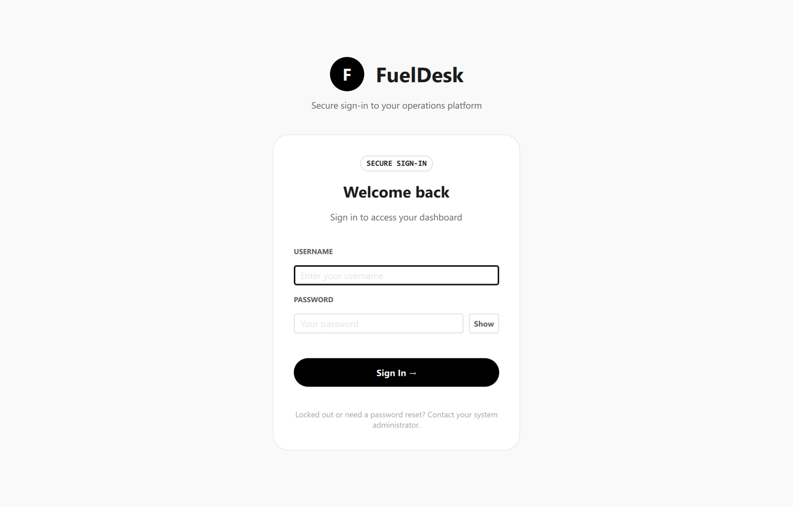 | 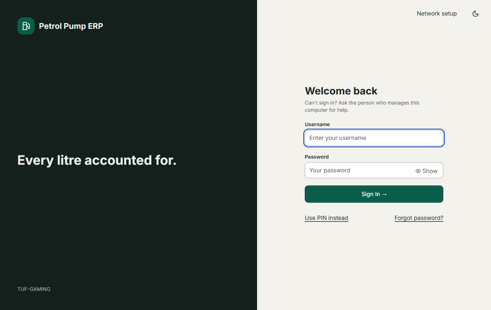 |
| **Shifts** | 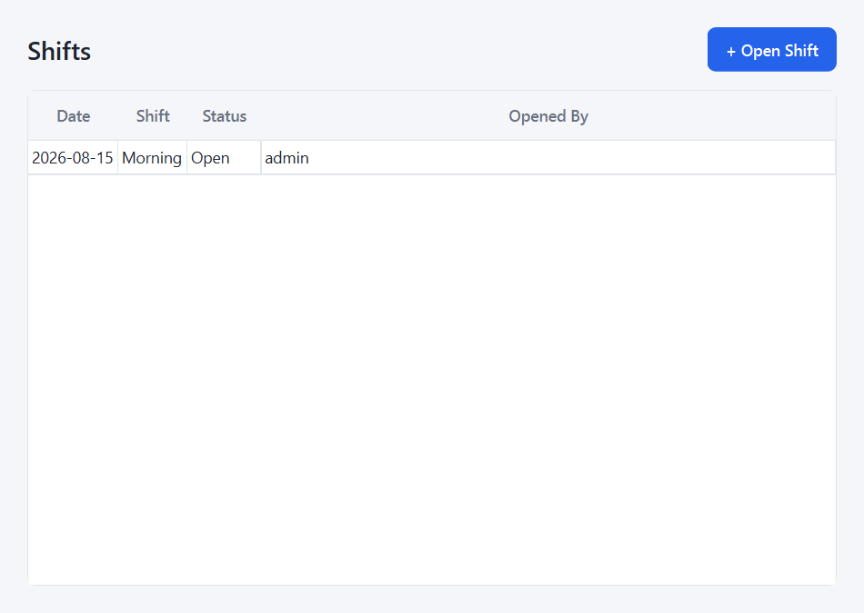 | 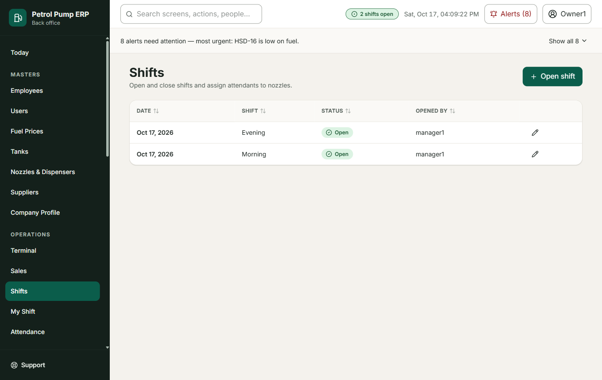 |
| **Tanks** | Gauge cards in `app/ui/tank_window.py` | 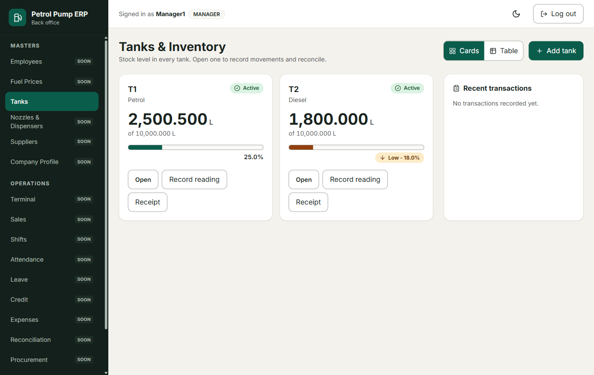 |

### The Electron app

| | |
|---|---|
| **Today (owner)**<br>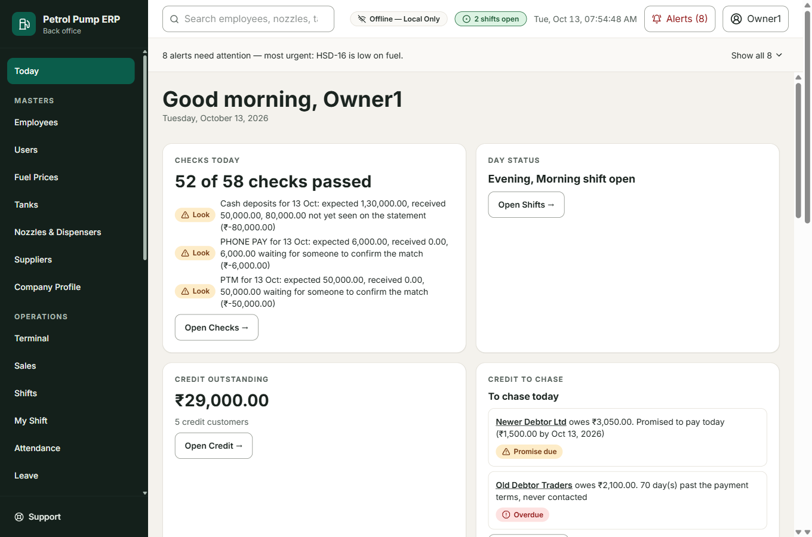 | **Close Shift** (tally on one screen)<br>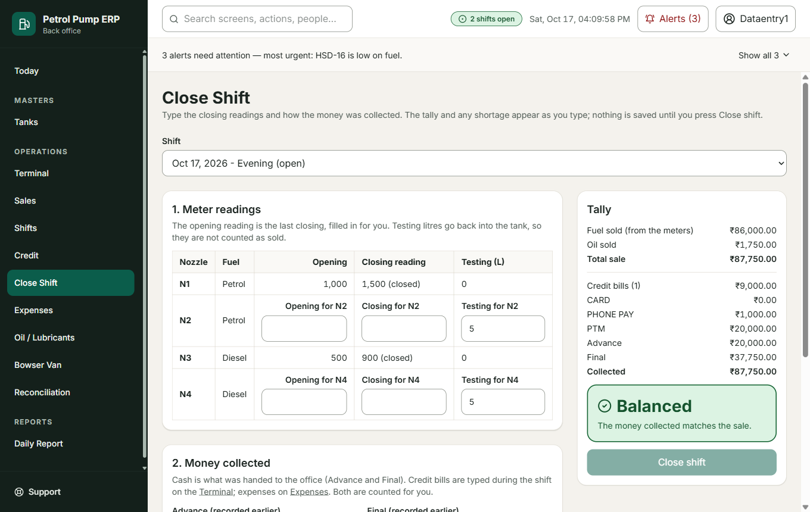 |
| **Checks** (every verification, failures first)<br>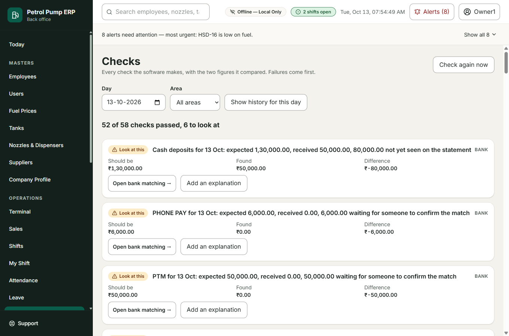 | **Daily Report**<br>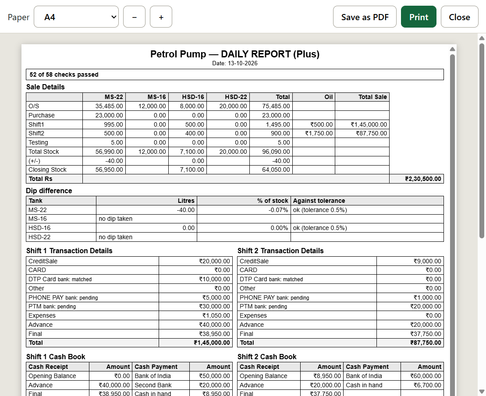 |
| **Credit ageing**<br>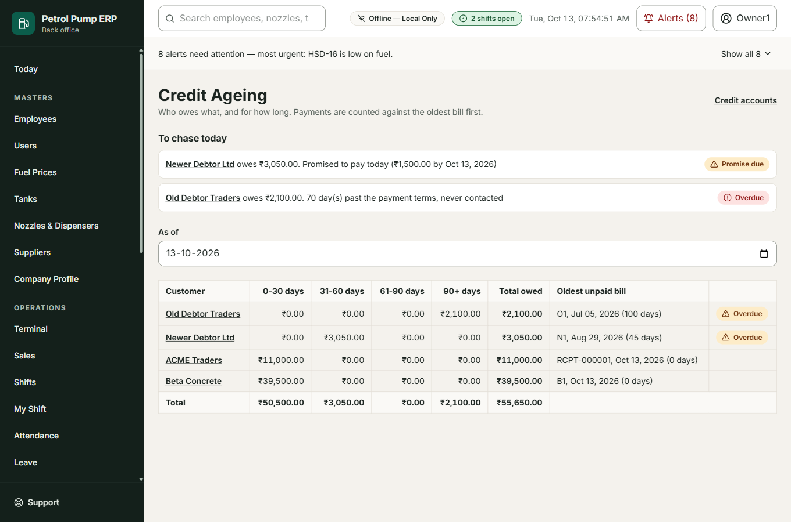 | **Bank matching**<br>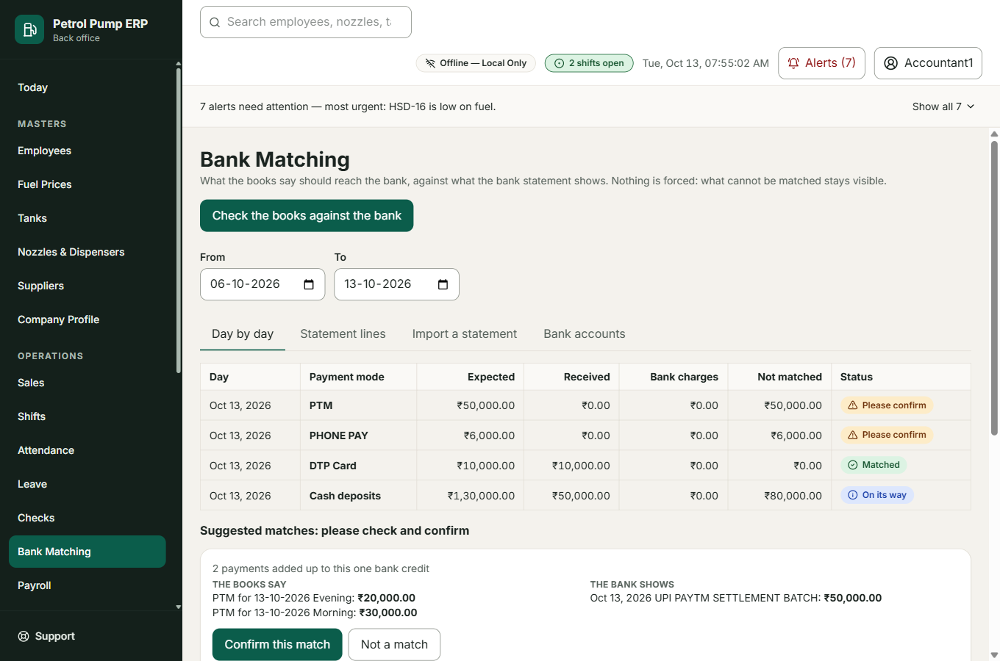 |
| **Devices** (PCs allowed on the Main PC)<br>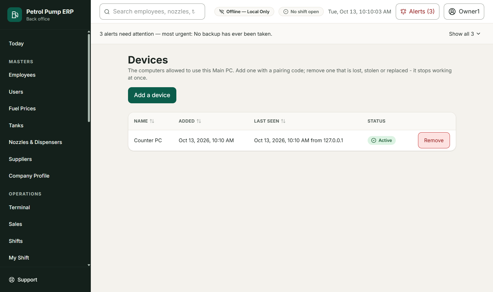 | **Tank variance, dark theme**<br>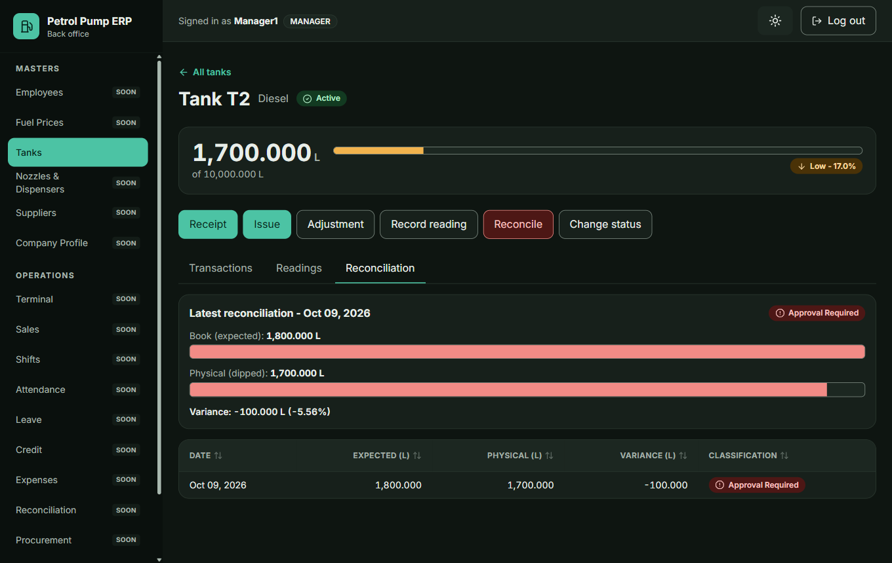 |

More pictures, with plain-language explanations, are in the [User Guide](docs/guides/USER_GUIDE.md).

---

## What the software does

Every module follows the same shape: model, repository, service (business rules, permission check, audit log), then a screen.

- **Sign-in and roles**: PBKDF2 password hashing, session expiry with auto-logout, lockout after five wrong passwords, PIN sign-in, screen lock, forced password change on first login, RBAC for Admin, Owner, Manager, Accountant, Shift Supervisor, Attendant and Data Entry.
- **Employees, attendance, leave, payroll**: status lifecycle (never deleted), documents, daily attendance with reasoned corrections, leave approval that writes attendance, payroll register with advances and Excel import.
- **Shifts and nozzles**: shift open/close/reopen, nozzle assignment with meter readings, dispensers and nozzles as master data.
- **Close Shift**: the cashier types closing meter readings and how the money was collected; a tally shows Balanced, Short or Excess before anything is saved, and the save is all-or-nothing.
- **Tanks and fuel**: stock book, dip readings and dip chart, receipts, issues and adjustments, variance classification (normal, warning, investigation, approval), fuel prices with history.
- **Procurement**: supplier, purchase order, tanker arrival, quality check, pre/post dip, unloading, invoice and supplier payment.
- **Sales, payments, credit**: every sale snapshots its own rate; credit limits and due windows; ageing, follow-ups and statements; lubricants and bowser van sales.
- **Expenses and reconciliation**: approval split from entry, per-shift cash, UPI and card reconciliation, employee shortage book, bank deposits and bank statement matching.
- **Checks**: independent verifications re-run after every save, append-only and audit-logged, shown with failures first.
- **Reports**: Daily Report (Classic and Plus), sales, payments, expenses, credit, reconciliation, business insights with a plain linear sales forecast. Every report supports preview, print, PDF and Excel.
- **Backups and safety**: automatic backup before migrations and on a schedule, integrity check, restore with a safety backup, audit-log viewer, system health.
- **Several PCs (LAN)**: a Main PC owns the one SQLite database; Client PCs hold no data. Devices are enrolled with a token, traffic is mutual TLS, and there is no plain-HTTP fallback. See [docs/LAN_SETUP.md](docs/LAN_SETUP.md).

Owner decisions (rounding, credit over the limit, usual testing litres and so on) are **settings with questionnaire IDs**, not hard-coded rules, and appear under *Owner Choices*.

---

## Architecture

```
React screens  ->  FastAPI routers (thin)  ->  Services  ->  Repositories  ->  SQLAlchemy  ->  SQLite
   web/               api/                    app/services    app/repositories                 (WAL, FKs)
   inside Electron (desktop/)
```

The Qt app uses the same stack from `Services` down; its UI simply calls the services directly:

```
PySide6 windows (app/ui)  ->  Services  ->  Repositories  ->  SQLAlchemy  ->  SQLite
```

Rules that keep it understandable:

- A screen never contains a business rule. A router never contains a business rule. A service never deletes history: it **voids, reverses or adjusts**, and writes the audit log.
- UUID primary keys, enforced foreign keys, transactions for every financial write, schema changes only through Alembic migrations (`python scripts/new_migration.py "message"`).
- A locked shift is enforced for every write path by `app/services/entry_lock_guard.py`.
- On a Main PC the audit chain depends on one writer (`api/lan/writelock.py`).

Full detail: [ARCHITECTURE.md](ARCHITECTURE.md) and [docs/SOFTWARE_MAP.md](docs/SOFTWARE_MAP.md).

| Concern | Choice |
|---|---|
| Language, back end | Python 3.13+, SQLAlchemy 2.x, Alembic, Pydantic v2, pydantic-settings |
| Database | SQLite, WAL mode, foreign keys on |
| Local API | FastAPI + uvicorn, packaged as a PyInstaller sidecar |
| New UI | React, TypeScript, Vite, Vitest |
| Desktop shell | Electron (fuses applied, inspector off), electron-builder (NSIS), Playwright |
| Original UI | PySide6, PyInstaller, Inno Setup |
| Reports | ReportLab (PDF), openpyxl (Excel), CSV |
| Tests | pytest, Vitest, Playwright |
| CI | GitHub Actions: `tests.yml` on every push, `release.yml` builds the Qt exe and installer on a version tag |

---

## Run it

You need **Python 3.13+**, and for the Electron app **Node.js 20+**.

### The Electron app (new)

```bash
# 1. Python side
python -m venv venv
venv\Scripts\activate                 # Windows;  source venv/bin/activate on macOS/Linux
pip install -r requirements.txt

# 2. Build the UI, then start the shell (it starts the Python API itself)
cd web && npm install && npm run build
cd ../desktop && npm install && npm start
```

Terminals that set `ELECTRON_RUN_AS_NODE=1` make Electron behave as plain Node; the npm scripts clear it for you.

### The Qt app (original)

```bash
python -m app.main
```

### First sign-in and data

Both apps create the database on first launch, apply every migration and seed roles and permissions. Sign in with `admin` / `Admin@123`; you are forced to choose a new password straight away. That default is a published development credential, so never leave it in place on a real pump.

| How you run it | Database |
|---|---|
| From source | `app/petrol_pump.db` |
| Installed or packaged | `%LOCALAPPDATA%\PetrolPumpERP\petrol_pump.db` (uninstalling never deletes it) |
| Override | set `PETROL_PUMP_DB_PATH` to any file |

Want realistic data? `python scripts/seed_demo_data.py` loads about ten weeks of throwaway history. For one demo day on the new screens, run `python desktop/e2e/seed_demo_day.py` with `PETROL_PUMP_DB_PATH` pointing at a new file.

---

## Tests

| Suite | Command | Count (last full run) |
|---|---|---|
| Python (services, API, LAN, Qt UI) | `pytest` | about 2,020 passed, 1 skipped |
| Web unit | `cd web && npm test` | 409 |
| Desktop unit | `cd desktop && npm test` | 48 |
| End to end (real Electron, real Python API) | `cd desktop && npm run e2e` | 64 passed, 12 opt-in skipped |

Run `npm run build` in `web/` before `npm run e2e`, because the e2e script does not rebuild the UI. Opt-in suites (installed app, deep install path, real printer, screenshots) are listed in [desktop/README.md](desktop/README.md). The Qt UI tests drive real widgets headlessly and never call `.exec()` on a modal dialog.

---

## Build installers

**Electron app** (see [desktop/README.md](desktop/README.md)):

```bash
cd web && npm run build
cd .. && pyinstaller api/pperp_api.spec --noconfirm --distpath desktop/sidecar-dist --workpath desktop/sidecar-build
cd desktop && npm run dist          # release/Petrol Pump ERP Setup <version>.exe
```

The build measures the longest path inside the app and fails above 130 characters (Windows path limits). Code signing is not done yet.

**Qt app**: `pyinstaller petrol_pump_erp.spec` for the single exe, then Inno Setup for the installer ([installer/README.md](installer/README.md)). Pushing a `v*.*.*` tag builds both on GitHub Actions and attaches them to a release.

---

## Project structure

```
PetrolPumpERP/
├── app/                  # Business logic shared by BOTH UIs
│   ├── core/             #   config, constants (roles, permissions), security, exceptions
│   ├── database/         #   engine, WAL/FK setup, seed, migrations runner
│   ├── models/           #   SQLAlchemy models, UUID keys
│   ├── repositories/     #   the only layer that talks SQL
│   ├── schemas/          #   Pydantic input validation
│   ├── services/         #   rules, RBAC, audit logging, checks, settings
│   └── ui/               #   PySide6 windows (the original UI)
├── api/                  # FastAPI sidecar: thin routers, check hook, LAN (api/lan)
├── web/                  # React + TypeScript UI (src/features/<screen>/)
├── desktop/              # Electron shell, Playwright e2e, packaging
├── alembic/              # Database migrations
├── tests/                # pytest (services, api, site, LAN, Qt UI)
├── scripts/              # demo data, migration helper, benchmarks
├── installer/            # Inno Setup script for the Qt app
├── docs/
│   ├── guides/           # User guide and network setup guide (with screenshots)
│   ├── migration/        # PySide6 -> Electron: reset point, log, report
│   ├── history/          # Build logs and audit reports from earlier sessions
│   ├── screenshots/      # Pictures used in this README
│   └── *.md              # ADRs, runbooks, specs, administrator and recovery guides
├── ARCHITECTURE.md  PROJECT_CONTEXT.md  ROADMAP.md  DEVELOPMENT_GUIDELINES.md
└── petrol_pump_erp.spec  # Qt build config
```

---

## Security and data integrity

- **RBAC everywhere**: service methods are guarded by `@require_permission`; the API reuses them, so the web UI cannot do what the role cannot.
- **Append-only audit log** with who, what, when, why and old/new values; the repository has no update or delete.
- **Never silently change history**: employees leave by status, documents are soft-deleted, sales are cancelled with a compensating entry, closed shifts reopen only with a reason under a stricter permission.
- **Passwords** are PBKDF2-HMAC-SHA256, 200,000 iterations, random salt. Session tokens are stored only as SHA-256 hashes.
- **Money** is `Decimal` everywhere, never `float`, and crosses the API as a string.
- **Backups** use SQLite's online backup API, are integrity-checked after creation, and a restore takes its own safety backup first.
- **Offline**: only `app/services/mail_service.py` may ever connect out, and it is optional and off by default.

---

## Documentation index

| Document | Purpose |
|---|---|
| [PROJECT_CONTEXT.md](PROJECT_CONTEXT.md) | Living project memory: done, pending, decisions, next task. Read first when picking the project up. |
| [ARCHITECTURE.md](ARCHITECTURE.md) | Layers, modules, diagrams |
| [ROADMAP.md](ROADMAP.md) | Phase-by-phase plan with checklists |
| [DEVELOPMENT_GUIDELINES.md](DEVELOPMENT_GUIDELINES.md) | Rules for working in this codebase |
| [problemstatement.md](problemstatement.md) | The original requirements |
| [docs/guides/USER_GUIDE.md](docs/guides/USER_GUIDE.md) | Illustrated guide for a first-time user (also as `.docx`) |
| [docs/guides/NETWORK_SETUP_GUIDE.md](docs/guides/NETWORK_SETUP_GUIDE.md) | Setting up the Main PC and Client PCs |
| [docs/administrator-guide.md](docs/administrator-guide.md) | Install, users, configuration, backups |
| [docs/recovery-guide.md](docs/recovery-guide.md) | Restore and data-problem recovery |
| [docs/first-shift-runbook.md](docs/first-shift-runbook.md) | The first live shift, step by step |
| [docs/MAIN_PC_RUNBOOK.md](docs/MAIN_PC_RUNBOOK.md) | Care and recovery for the Main PC |
| [docs/OFFLINE_ACCEPTANCE.md](docs/OFFLINE_ACCEPTANCE.md) | Owner's offline acceptance test (not yet performed) |
| [docs/PRINTING_TEST.md](docs/PRINTING_TEST.md) | Printing check on a real printer (not yet performed) |
| [docs/history/](docs/history/) | Build logs and audit reports, kept for the record |

---

## Status and what is next

**Done**: every Qt window has an Electron screen, plus the site-visit screens (Today, Checks, Close Shift, Daily Report, credit control, bank matching, payroll), multi-PC LAN mode, a pilot-readiness audit and a walk-through round of fixes.

**Needs a human on real hardware** (cannot be proven from a development PC):

- Printing on a real printer, and the offline acceptance test with the network cable out.
- Windows Hello on the lock screen.
- Memory on an old pump PC.
- A first live pilot at a pump, then the final release.

Open questions for the owners are listed in [docs/history/WALKTHROUGH_2026-10-17.md](docs/history/WALKTHROUGH_2026-10-17.md). The full phase table is in [ROADMAP.md](ROADMAP.md).

## License

Proprietary. All rights reserved.
