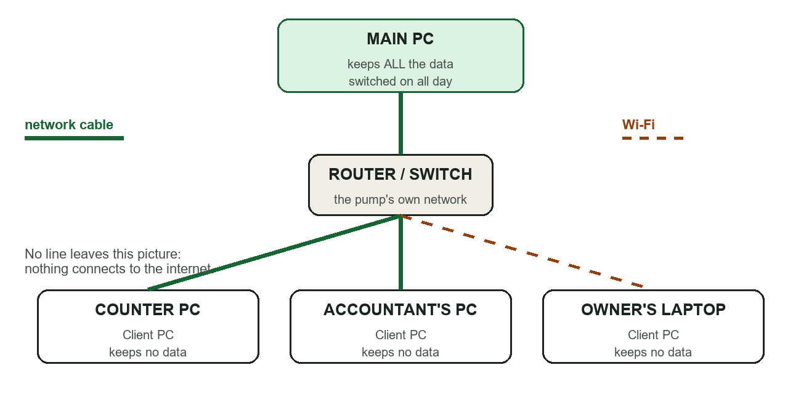
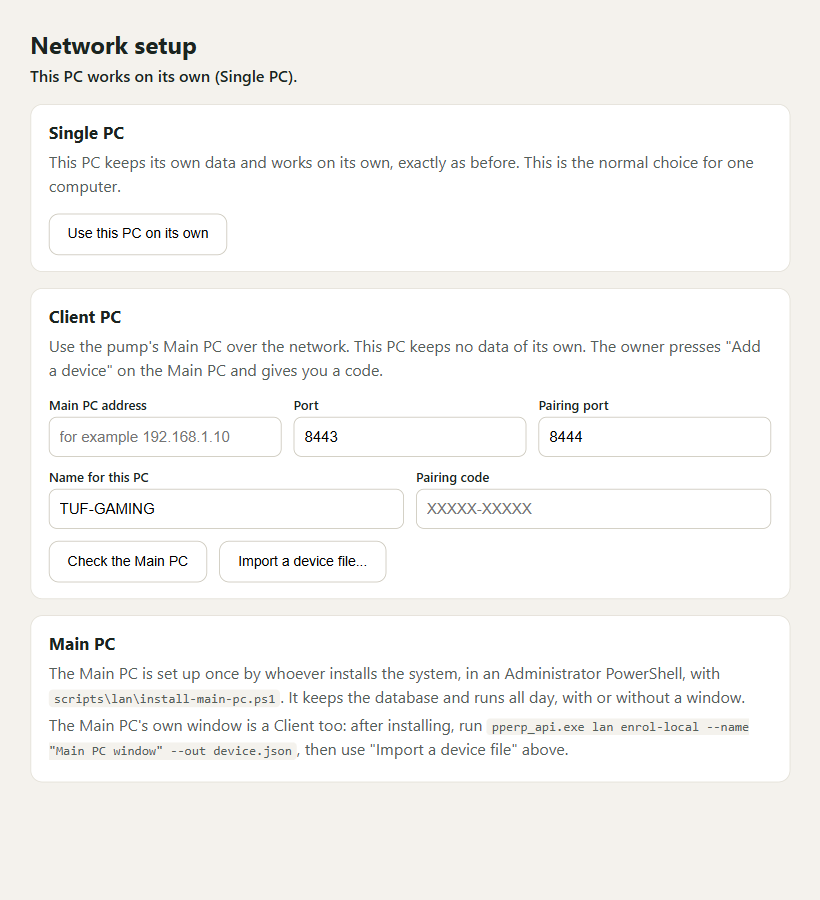
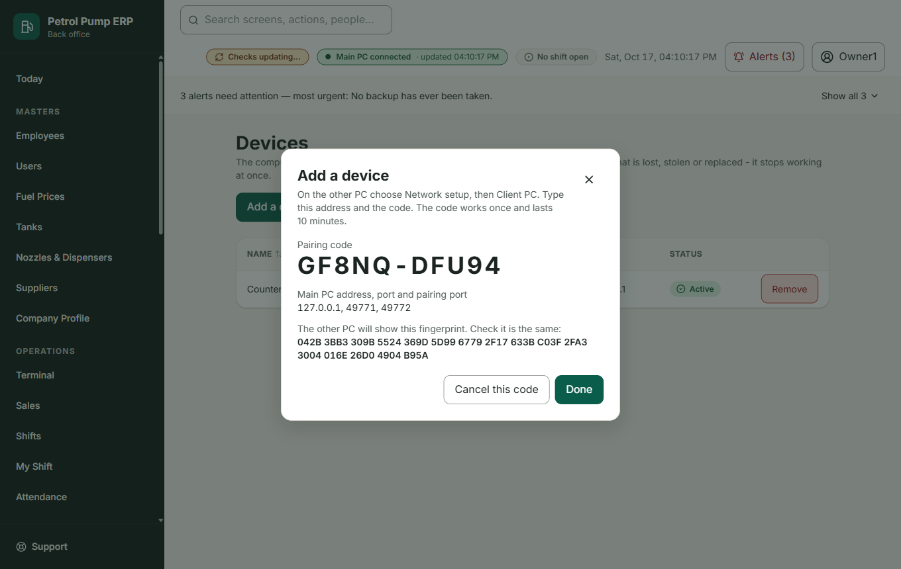
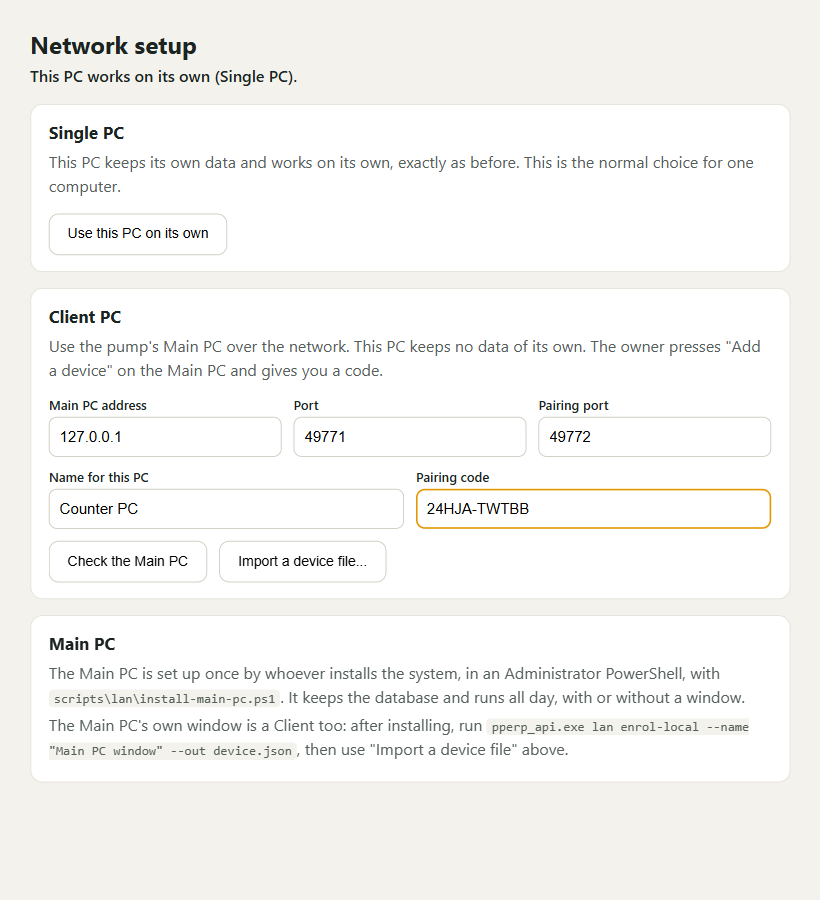
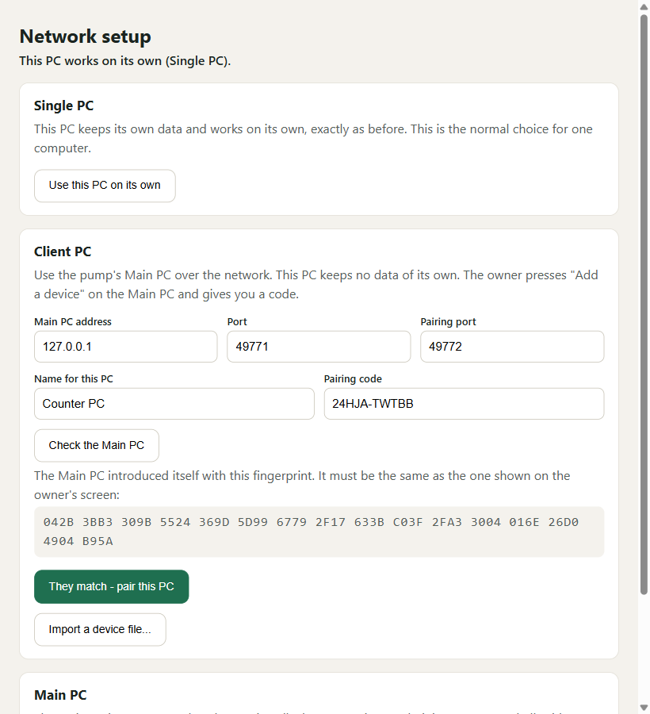
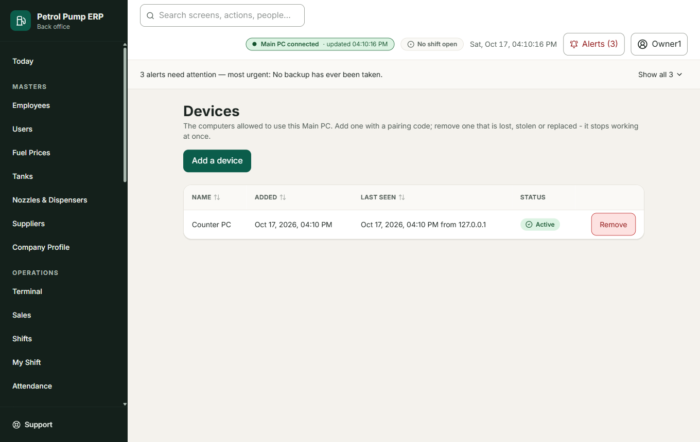

# Network Setup Guide: several computers at the pump

Written for the person setting up the computers at the pump: the owner, or a technician. You do not need to know how networks work. Every step says what you are doing and why.

The care and recovery steps (what to do if the Main PC dies) are in `docs/MAIN_PC_RUNBOOK.md`. This guide gets you running.

---

## 1. What "Single", "Main" and "Client" mean

There are three ways a computer can run the program.

| Mode | What it is | When to use it |
|---|---|---|
| **Single PC** | One computer that keeps its own data and works on its own. | A pump with one computer. This is how the program starts. |
| **Main PC** | The one computer that **keeps all of the pump's data**. It stays switched on all day. | A pump with two or more computers. There is **only one** Main PC. |
| **Client PC** | A computer that works on the Main PC's data over the network. It **keeps no data of its own**: everything it shows is read from the Main PC, and everything typed on it is saved on the Main PC. | Every other computer: the counter, the accountant's desk, the owner's laptop. |

Because a Client PC keeps nothing, losing, breaking or replacing one never loses any data.

## 2. How the computers connect



All the computers are joined to the pump's own network by a **network cable** or **Wi-Fi**, through the **router** (or a switch). The Main PC is the one in the middle. Nothing connects to the internet or to the outside: this network is the pump's own.

You can mix cable and Wi-Fi. Cable is steadier; use it for the Main PC if you can.

## 3. Before you start

Gather these:

* The computer that will be the **Main PC**. It should stay on all day and be somewhere safe.
* All the other computers, each with the program installed, joined to the **same router** as the Main PC.
* The program's installer files, and the folder `scripts\lan` that comes with them.
* An **owner's sign-in** (to add the other computers later).
* A **USB stick or a second drive** for backups, kept away from the Main PC.

## 4. Making one computer the Main PC

Do this **once**, on the computer you chose.

### Step 1. Give it a fixed address

Every computer on a network has an address, like a house number, for example `192.168.1.10`. By default the router may change it from time to time. The Main PC needs an address that never changes, because every other computer looks for it there.

1. On the Main PC press the Windows key, type `cmd` and press Enter. A black window opens.
2. Type `ipconfig` and press Enter. Find the line **IPv4 Address**. Write it down. This is the address, for example `192.168.1.10`.
3. Open your router's settings page (the router's manual says how; often a web address printed on the router). Find **DHCP reservation** (also called "address reservation" or "static lease") and reserve that address for this computer. If you do not know how, ask whoever installed the router.

### Step 2. Make it private and protect the disk

1. **Network type.** Windows Settings, then Network. Set the connection to **Private**. (This tells Windows the network is a trusted one, such as your own pump.)
2. **BitLocker.** Windows: search for **Manage BitLocker** and turn it on for the drive that holds the data. This scrambles the disk, so if the computer or its disk is stolen nobody can read the data. **Keep the recovery key somewhere safe and not on this computer.**
3. Every Windows administrator account on this computer needs a strong password.

### Step 3. Run the setup script

This step uses **PowerShell**. PowerShell is a window where you type instructions to Windows instead of clicking. **"As Administrator"** means the window is allowed to change settings for the whole computer; without it the script cannot do its job.

1. Press the Windows key, type `PowerShell`, right-click **Windows PowerShell** and choose **Run as administrator**. Press **Yes**.
2. Go to the folder with the files, for example: `cd C:\PetrolPumpERP`
3. First do a **practice run**, which changes nothing and only lists what it would do. Type the line below with your own address (the one from Step 1) and your own network (the first three numbers of your address followed by `.0/24`, so `192.168.1.0/24`):

   ```
   .\scripts\lan\install-main-pc.ps1 -Exe 'C:\PetrolPumpERP\pperp_api.exe' -Address 192.168.1.10 -Subnets 192.168.1.0/24 -DryRun
   ```

4. Read the list. When it looks right, type the **same line without `-DryRun`**.

What the script does, in plain words:

* It **locks the data folder** so only Windows administrators can open it.
* It makes the pump's **own security keys**, so that only computers you approve can connect.
* It **opens the doors in the Windows firewall** for the two network "ports" the program uses, and **only for your pump's network**, nothing else.
* It sets the program to **start by itself** every time the computer starts, with no window and no one signed in.

If the program already holds data from when it ran as a Single PC, take a backup first and restore it into the Main PC following the runbook (section 4), before the first start.

### Step 4. Let the Main PC's own screen use the program

The Main PC's own window also connects like a Client. In the same PowerShell window type:

```
pperp_api.exe lan enrol-local --name "Main PC window" --out device.json
```

Then open the program, press **Network setup** on the sign-in page, press **Import a device file** and choose `device.json`. **Delete `device.json` afterwards.**



The Main PC is now ready. It needs nothing more each day: it takes backups by itself.

## 5. Adding each Client PC

For every other computer, repeat this. It takes about five minutes.

### On the Main PC: get a pairing code

1. Sign in as an **owner**.
2. Open **Devices** in the Settings menu, and press **Add a device**.
3. A **pairing code** (ten characters) and a **fingerprint** appear. The code works **once** and lasts **ten minutes**. Keep the window open.



### On the Client PC: connect

1. Open the program. On the sign-in page press **Network setup**.
2. In the **Client PC** box fill in:
   * **Main PC address**: the address you wrote down in Step 1 (for example `192.168.1.10`). Leave the ports as they are.
   * **Name for this PC**: something people will recognise, such as *Counter PC*.
   * **Pairing code**: the code from the Main PC.



3. Press **Check the Main PC**.
4. **Compare the fingerprint.** The Client PC now shows a fingerprint (a line of letters and numbers). The Main PC's screen shows one too. They **must be exactly the same**. Read them out loud to each other, or photograph one. This proves the Client is really talking to your Main PC and nothing is in between.



5. **Only if they are the same**, press **They match - pair this PC**. If they differ, **stop**, do not pair, and tell the owner: something is between the two computers.
6. Press **Test connection**. The sign-in page now works as usual, and everything you see comes from the Main PC.

## 6. How to check that it works

* On the Client PC the **top bar shows a light**: **green** means connected and live; **amber** means connected but refreshing every 20 seconds; **red** means the Main PC cannot be reached.
* Type something on the Client PC (for example add an employee) and open the same screen on another PC. It appears there within a few seconds.
* On the Main PC open **System Health**. Everything should say **Good**.



## 7. If the Main PC is switched off

* Client PCs show a red light and a message: *The Main PC cannot be reached.* You can still read what is on the screen, but **nothing can be saved** until the Main PC is back. They try again by themselves every few seconds.
* Switch the Main PC back on. It starts the program by itself. Nothing typed on the Client PCs was lost, because nothing could be saved while it was off.
* Keep the paper for anything that happened in the meantime and type it in afterwards.

## 8. Removing a computer

If a computer is lost, stolen, sold or replaced:

1. On the Main PC, open **Devices**.
2. Find the computer and press **Remove**. Give a reason.
3. It **stops working at once**, even if someone has its keys. A removed computer leaves no data behind because Client PCs keep none.
4. To set up a replacement, add it as in section 5 with a new code.

## 9. If the Main PC itself breaks

See `docs/MAIN_PC_RUNBOOK.md`, section 4. In short: set up a replacement as in section 4, restore the newest backup with `lan promote`, and add each Client PC again. This is why a backup on a USB stick matters.

## 10. Never

* Never open the pump's network to the internet (no "port forwarding").
* Never run the program as a Single PC on the Main PC while it is the Main PC. It refuses, to protect the data.
* Never send the pairing code or the backup passphrase in a message.
* Never copy the database file by hand while the program runs. Use the **Backups** screen.

## 11. If something does not work

| What you see | What to do |
|---|---|
| "Cannot reach the Main PC" | The Main PC is off, or this computer is not on the pump's network. Check both |
| "This PC is not allowed on the Main PC" | It was removed, or it is on a different network. The owner adds it again from Devices |
| Pairing says "failed" | The code is wrong, was already used, or is older than ten minutes. Ask for a new one |
| The fingerprints differ | **Stop.** Do not pair. Tell the owner |
| System Health shows red | See the runbook, section 2 |
