# Petrol Pump ERP: User Guide

Written for someone who has never worked at a petrol pump. Every picture comes from the real screens, filled with made-up demo data (no real names or figures).

If you only have five minutes, read **Part 1** and the **Glossary** at the end.

---

## Part 1. How the pump day works, and how this program follows it

A petrol pump sells fuel from **tanks** buried in the ground. Each tank is filled by a **tanker** (a delivery truck) and emptied slowly by customers at the **nozzles** of the **dispensers** (the machines on the forecourt). Each nozzle has a **meter**, like the odometer of a car, that counts every litre that has passed through it.

The day is cut into **shifts** (for example Morning and Evening). Here is what happens, and which screen records it:

| What happens at the pump | Where you record it |
|---|---|
| A tanker arrives with fuel | **Tanks**, then the tank, then **Receipt** (or **Procurement** for the full paperwork) |
| The attendants sell fuel all shift | Nothing is typed for each sale. The nozzle meters count everything |
| A credit customer (a transport company that pays later) is billed | **Terminal** |
| A customer pays with the oil company's fleet card (DTP Card) | **Terminal** |
| The shift ends. Someone reads each nozzle's meter and counts the money | **Close Shift** |
| The owner or accountant checks the figures against the paper | **Review** |
| The day's report is printed | **Daily Report** |
| Money is taken to the bank | **Reconciliation** (deposits), then **Bank Matching** |
| Staff are paid | **Attendance** and **Payroll** |

### The idea behind everything

* **Nothing is deleted.** If something was typed wrongly it is corrected, voided or reversed, and the original stays visible. Every change is written to the **Audit Log** with who made it and when.
* **The program checks itself.** After you save, it re-runs a set of **Checks** (for example "litres sold equal litres through the meters") in the background. A small "Checks updating" label appears for a moment. A failed check never stops you working, but a day with a failed check cannot be **locked** without an owner's reason.
* **The owners decide the rules.** Choices such as "who may lock a shift" are on **Owner Choices**, not hidden in the program.
* **It works with no internet.** Nothing leaves the computer. The one optional exception is the owners' daily email summary, which is off until switched on.

### Who sees what

Each person signs in with their own name and sees only the screens their role allows. This table is built from the program's own permission list.

| Screen | Who can open it |
|---|---|
| Employees | Admin, Owner, Manager, Accountant, Shift Supervisor |
| Users | Admin, Owner |
| Fuel Prices | Admin, Owner, Manager, Accountant, Shift Supervisor, Attendant |
| Tanks | Admin, Owner, Manager, Accountant, Shift Supervisor, Data Entry |
| Nozzles and Dispensers | Admin, Owner, Manager, Accountant, Shift Supervisor |
| Suppliers and Procurement | Admin, Owner, Manager, Accountant |
| Company Profile | Admin, Owner, Manager, Accountant, Shift Supervisor, Attendant |
| Terminal | Admin, Owner, Manager, Shift Supervisor, Data Entry. Attendants only if the owners switch on Owner Choice W-33 |
| Sales | Admin, Owner, Manager, Accountant, Shift Supervisor, Attendant, Data Entry |
| Shifts | Admin, Owner, Manager, Accountant, Shift Supervisor, Data Entry |
| My Shift | Admin, Owner, Attendant |
| Attendance and Leave | Admin, Owner, Manager, Accountant, Shift Supervisor |
| Daily Digest | Admin, Owner |
| Checks and Review | Admin, Owner, Manager, Accountant |
| Bank Matching and Payroll | Admin, Owner, Accountant |
| Credit | Admin, Owner, Manager, Accountant, Data Entry |
| Credit Ageing | Admin, Owner, Manager, Accountant |
| Close Shift | Admin, Owner, Manager, Shift Supervisor, Data Entry |
| Card, DTP and Phone Pay totals | Admin, Owner, Manager, Shift Supervisor |
| Expenses, Oil, Bowser Van | Admin, Owner, Manager, Accountant, Data Entry |
| Reconciliation | Admin, Owner, Manager, Accountant, Shift Supervisor, Data Entry |
| Daily Report | Admin, Owner, Manager, Accountant, Data Entry |
| Reports | Admin, Owner, Manager, Accountant, Shift Supervisor, Attendant |
| Owner Choices, Backups, Devices, System Health, Email Summary | Admin, Owner |
| Audit Log | Admin, Owner, Manager, Accountant |

In practice the pump's attendants do not sign in at all: they work the nozzles and hand their takings to the office.

---

## Part 2. Finding your way around

### Signing in

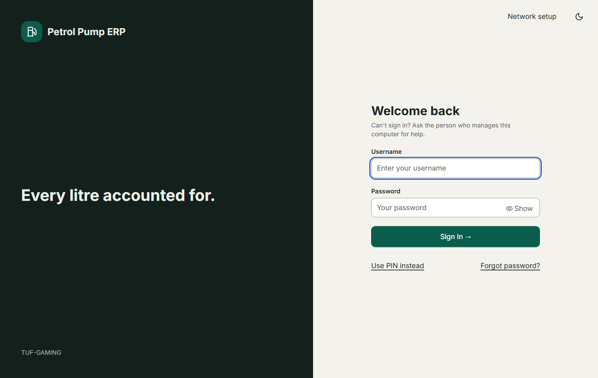

Type your user name and password and press **Sign in**. **Show** reveals the password for a few seconds, then hides it again by itself. **Use PIN instead** signs you in with the six-digit quick PIN you set in your account menu. **Forgot password** asks for a reset code that an administrator generates for you. The bottom left shows which computer you are on.

If the wrong password is typed too many times the account locks for fifteen minutes. An administrator can unlock it sooner on the **Users** screen.

### The top bar

* **Search box** (press **Ctrl+K**): type a screen, an action or a name. It forgives typing mistakes, and knows the pump's other words (petrol is MS, diesel is HSD, salary is payroll, udhaar is credit). See the picture below.
* **Shift label**: "No shift open" or the name of the open shift.
* **Checks updating**: appears for a moment after you save while the program re-checks the day.
* **Clock**, **Alerts** (count of things needing attention) and your **account menu**.

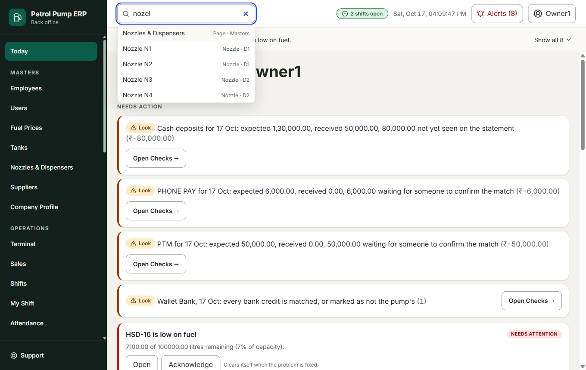

### Your account menu

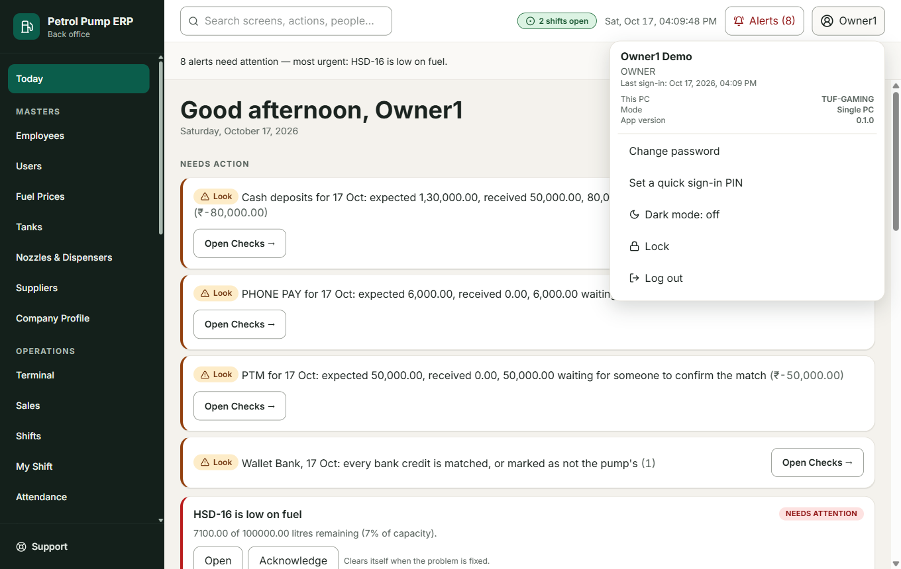

Shows when you last signed in, **which PC this is, what kind of PC it is (Single, Main or Client) and the program version**. From here you can **Change password**, set a **quick sign-in PIN**, switch **Dark mode**, **Lock** the screen (the program stays open and asks for your password or PIN) and **Log out**.

---

## Part 3. Today

### Today (the home screen)

**Open it from:** the first item in the menu. **Who:** everyone who signs in.

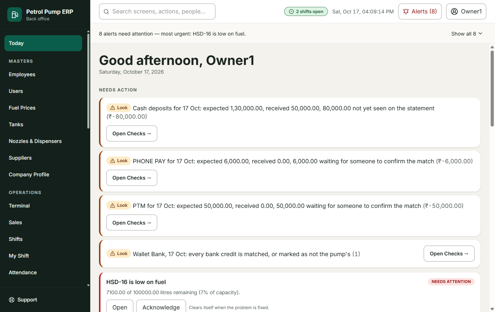

**What it is for:** to show you, first, what needs you, then the day in five short sections.

1. **Needs action.** The things waiting for you, in words: for example "3 entries need your check" with a **Review** button, any failed checks, and your **alerts**. Every alert has buttons (see *Alerts*).
2. **Today's sales:** number of sales, revenue, tanks running low.
3. **Shifts open and who is on them.**
4. **Tank levels**, drawn as pictures of the tanks.
5. **Credit to chase:** customers who promised to pay, or who are late.

The link **More** at the bottom opens the rest (sales trend, the month's payroll, purchase orders, the daily digest) so that Today stays short.

**What it changes:** nothing. It only shows.

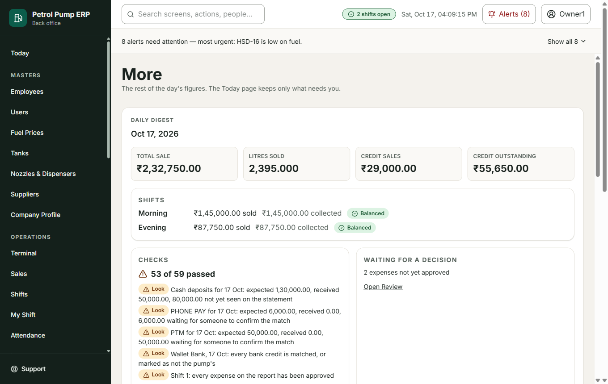

### Alerts

**Open it from:** the **Alerts** button in the top bar, or the strip under it.

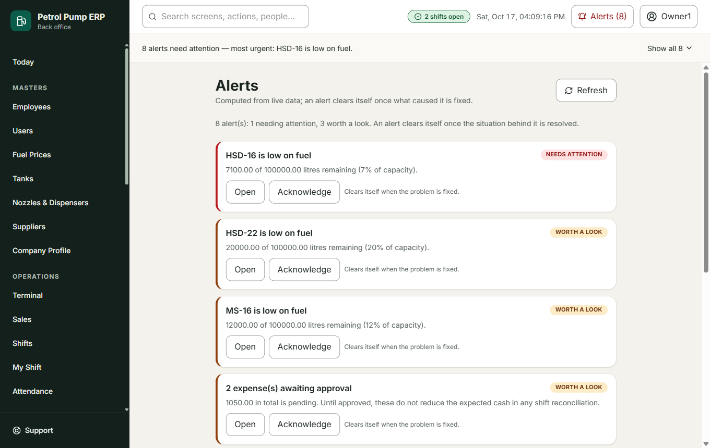

An alert is a warning worked out from live data: a tank running low, a cash shortage, a customer waiting for approval.

Every alert has three ways to deal with it:

* **Open** goes to the screen the alert is about.
* **Resolve** happens by itself: when the problem is fixed the alert disappears.
* **Acknowledge** sets the alert aside **for the rest of today**. You must give a reason. Who did it, when, and why are recorded. Acknowledging never changes a check: a failed check still counts as failed when someone tries to lock the day.

The same alert about the same thing shows **once, with a count** ("× 3").

**A cash shortage alert** shows who worked that shift and has a button **Mark against (name)**. It books the missing money as a shortage owed by that person (see *Reconciliation* and *Employees*) and the alert goes away. If more than one person worked the shift, choose the right one first.

### Checks

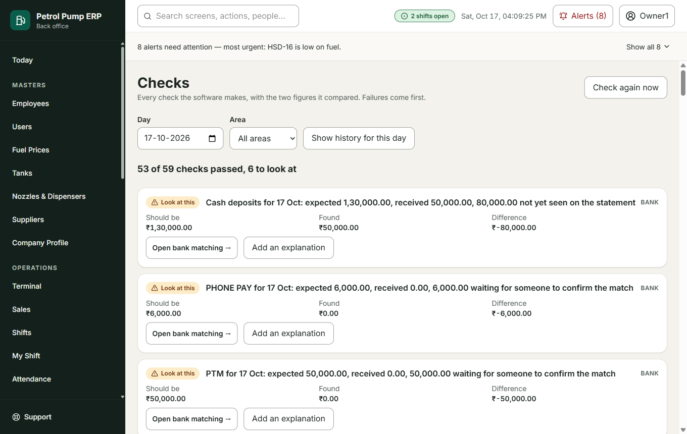

Every check the program makes, with the two figures it compared, **failures first**. **Day** and **Area** filter the list. **Check again now** re-runs them. **Add an explanation** attaches a note ("the cash was counted twice, corrected on Friday"). An explanation is kept with the result but **never changes the result**.

### Review

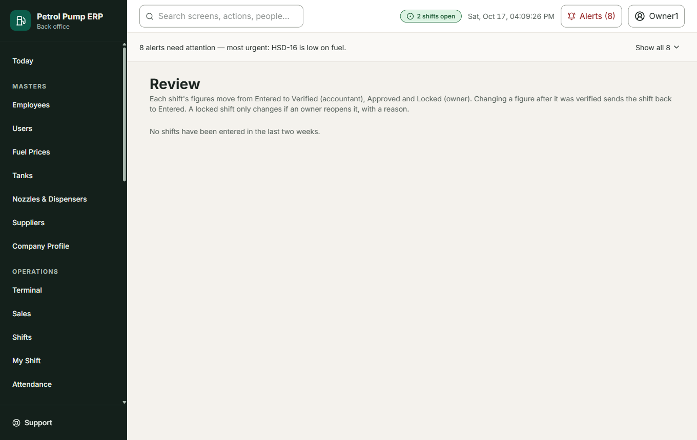

Each shift moves through four steps: **Entered** (the figures were typed on Close Shift), **Verified** (the accountant compared them with the paper), **Approved** (an owner accepted them) and **Locked** (closed for good: nothing under it can be changed). Only the next step you are allowed to take is offered.

* **Verify, Approve, Lock** move the shift forward.
* If a check is failing for that day, **Lock** stops and shows what is failing. An owner can still **Lock anyway** by giving a reason, which is recorded (Owner Choice V-07).
* **Reopen** (owners, with a reason) sends a locked or verified shift back to Entered so it can be corrected.
* If anyone changes a figure after it was verified, the shift goes back to Entered by itself and says so.

### Daily Digest

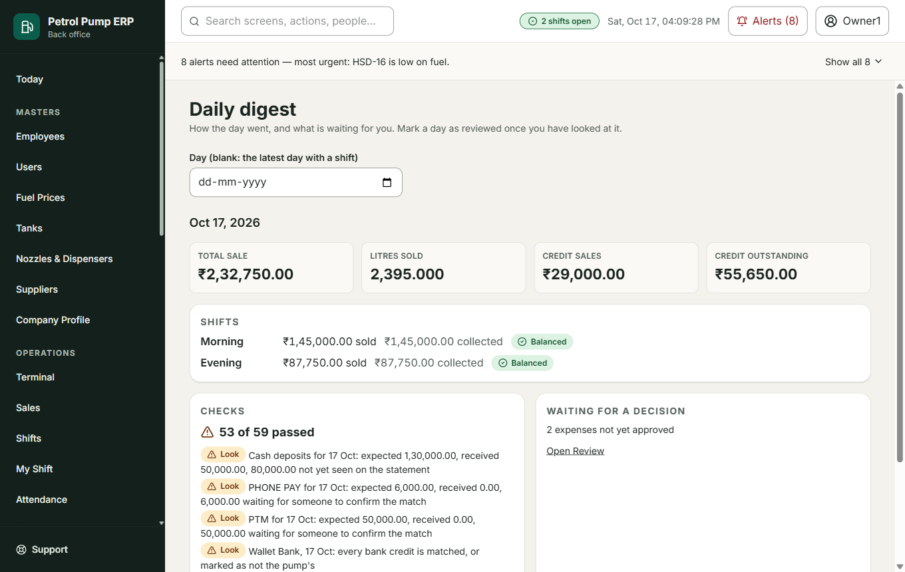

**Owners.** How the day went on one page: total sale, litres, credit sales, credit outstanding, each shift (sold, collected, short or excess), the checks, and what is waiting for a decision. **Mark as reviewed** records that you have looked at it. Each owner has their own mark.

---

## Part 4. Masters (the lists that rarely change)

### Employees

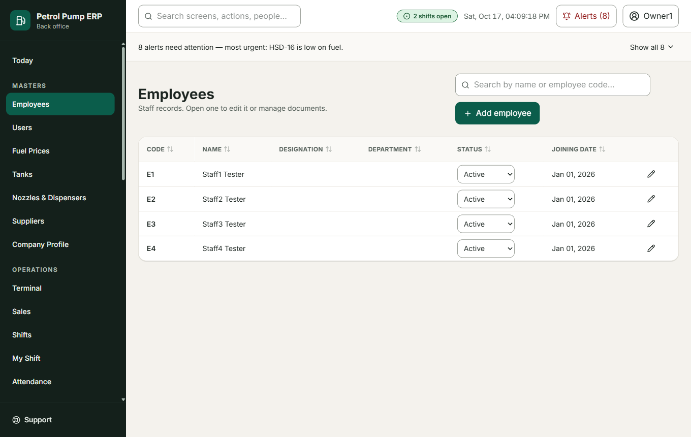

**What it is for:** the staff list. **Add employee** asks for name, contact number, and optionally email, designation, department, outlet, joining date and an emergency contact. Open an employee to **Save profile**, **Change status** (Active, On leave, Suspended, Terminated, with a reason), **Record exit** or add and remove **Documents** (a reference to a scanned ID, with a reason when removed).

The employee's page also lists **cash shortages** marked against them: how much was short, how much they owe, and each repayment. These are facts, not a score. Nothing is taken from their pay automatically.

**What it changes:** the staff record only. An employee who has left is marked exited, never deleted.

### Users

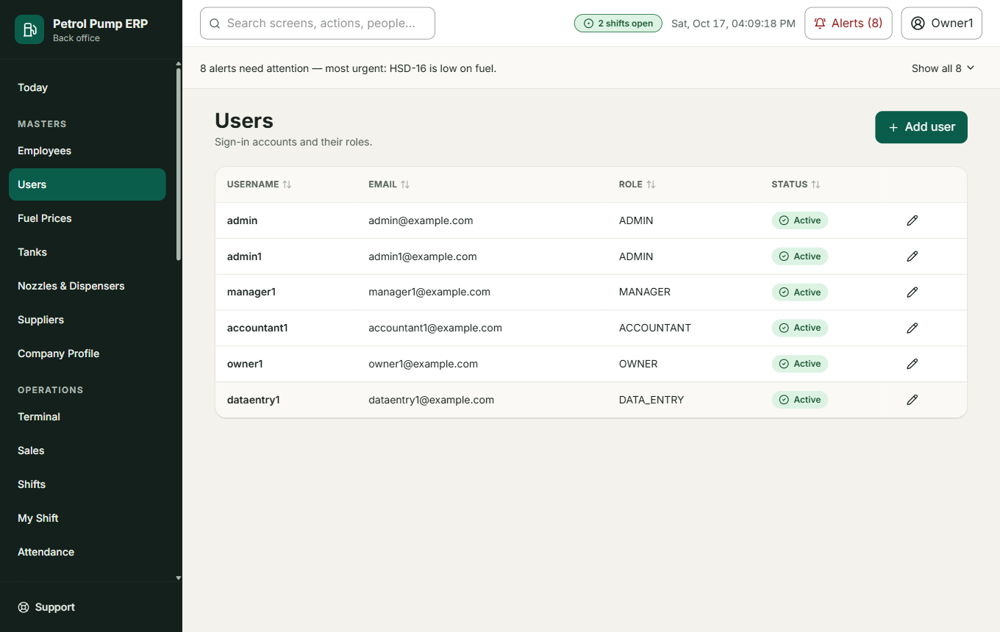

**Owners and admins.** A **user** is a sign-in account; an **employee** is a person on the payroll. **Add user** asks for user name, email, names, a role and a password. The rules for the password (at least 8 characters, a capital letter, a small letter and a number) are shown under the field before you save. Open a user to **Change role**, **Reset password** (they must choose their own at next sign-in), **Generate password reset code**, **Unlock account** or deactivate the account.

### Fuel Prices

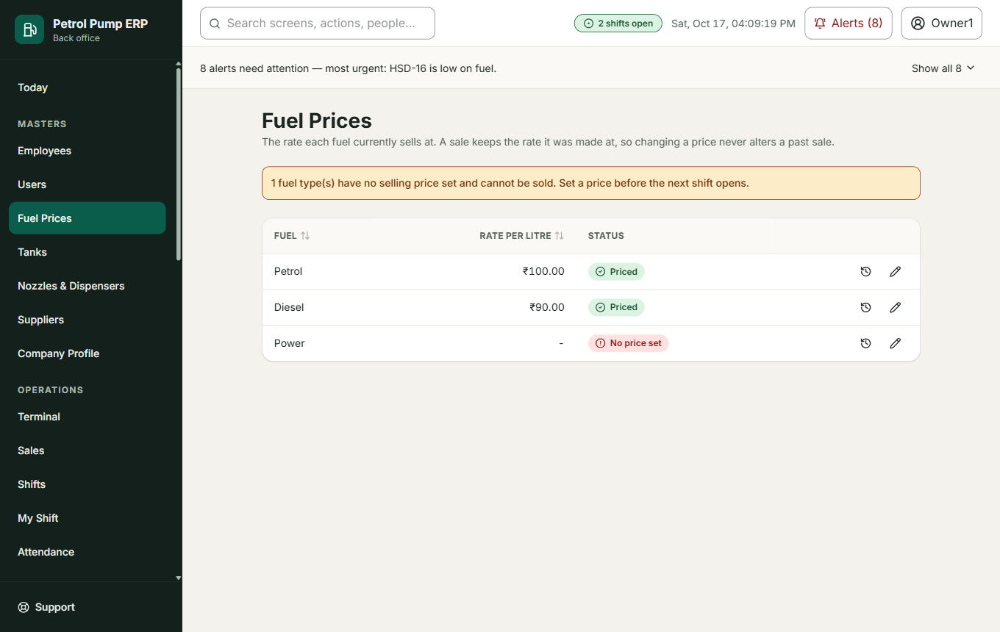

The rate each fuel sells at today. **Save** a new rate with a reason. **A sale keeps the rate it was made at**, so changing a price never changes a past sale. The history of every price is shown.

### Tanks and Inventory

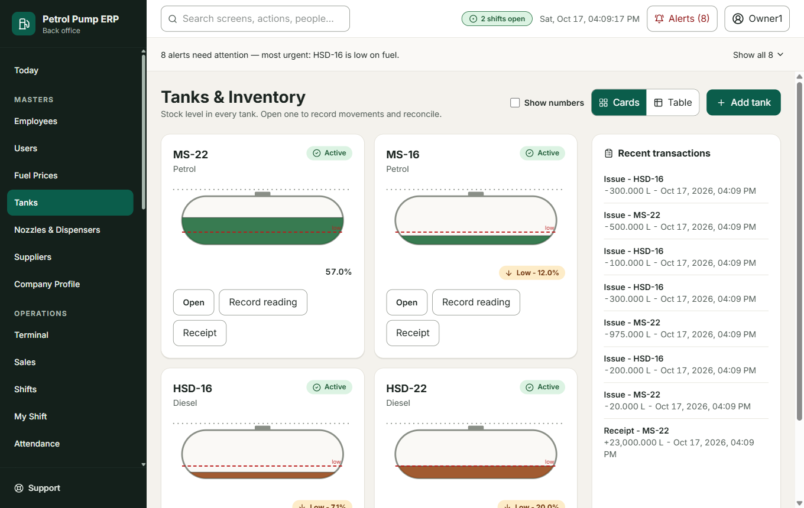

**What it is for:** the stock in each underground tank, drawn the way it lies in the ground: a long body with rounded ends, the fuel level inside, a colour for the fuel (green petrol, amber diesel), and a dashed line where "low" starts.

* The **picture is the main view**. Tap or hover a tank to see the numbers, or tick **Show numbers** to see them on every tank (the choice is remembered for you).
* The numbers: **In the tank (book stock)**, how full it is, the capacity, and the last dip.
* **Cards or Table** switches the view. **Add tank** asks for a code (the owners' names are MS-22, MS-16, HSD-16 and HSD-22: MS is petrol, HSD is diesel), the fuel, capacity and opening stock. **Record reading** and **Receipt** are quick actions.

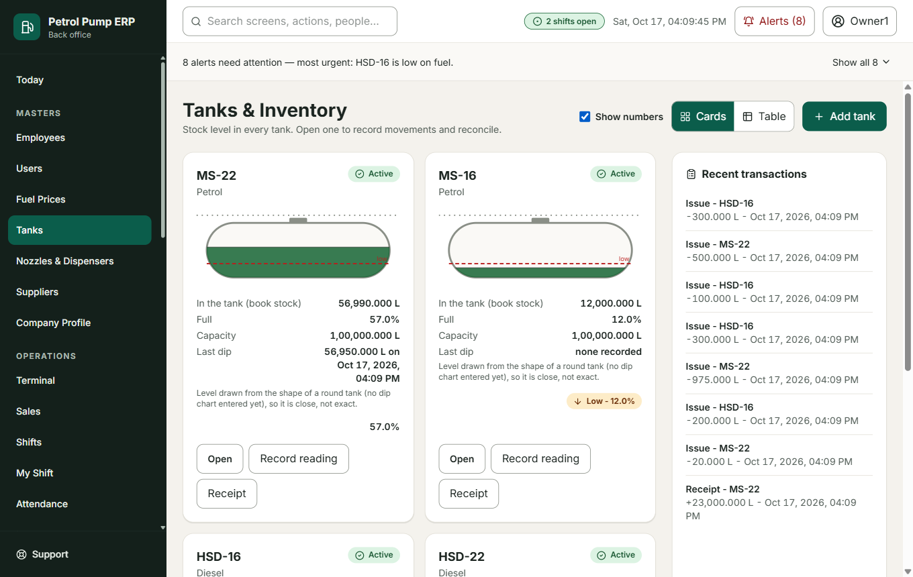

**How high the fuel stands.** Because a tank lies on its side, litres do not rise evenly with height. The picture uses the tank's **dip chart** if one has been entered. If not, it uses the formula for a round tank, and says so ("close, not exact").

#### One tank

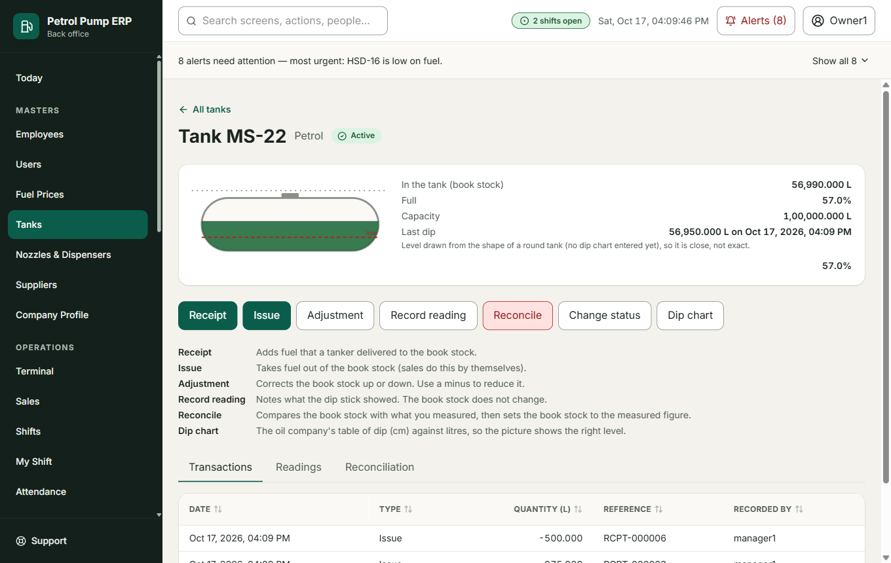

Each button changes something different, and the page says so in one line each:

| Button | What it changes |
|---|---|
| **Receipt** | Adds fuel that a tanker delivered to the **book stock** |
| **Issue** | Takes fuel out of the book stock (sales do this by themselves) |
| **Adjustment** | Corrects the book stock up or down. A minus reduces it |
| **Record reading** | Notes what the dip stick showed. **The book stock does not change** |
| **Reconcile** | Compares the book stock with what you measured, then sets the book stock to the measured figure |
| **Change status** | Active, inactive or in maintenance |
| **Dip chart** | The oil company's table of dip (cm) against litres, so the picture shows the right level |

**Book stock** is what the program believes is in the tank (what was received minus what was sold). **Physical stock** is what you actually measure with a dip stick. The difference is the **variance**, shown as bars on the Reconciliation tab.

#### The dip chart

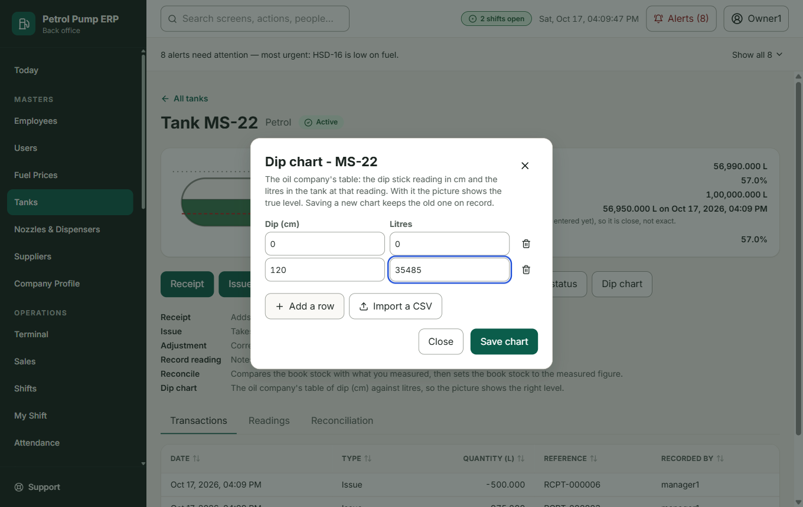

The oil company gives each tank a table: "at 50 cm on the stick there are 5,000 litres". Type it in row by row, or **Import a CSV** (two columns: dip, litres). The rows must rise, and the chart cannot reach more litres than the tank holds. Saving a new chart keeps the old one on record.

### Nozzles and Dispensers

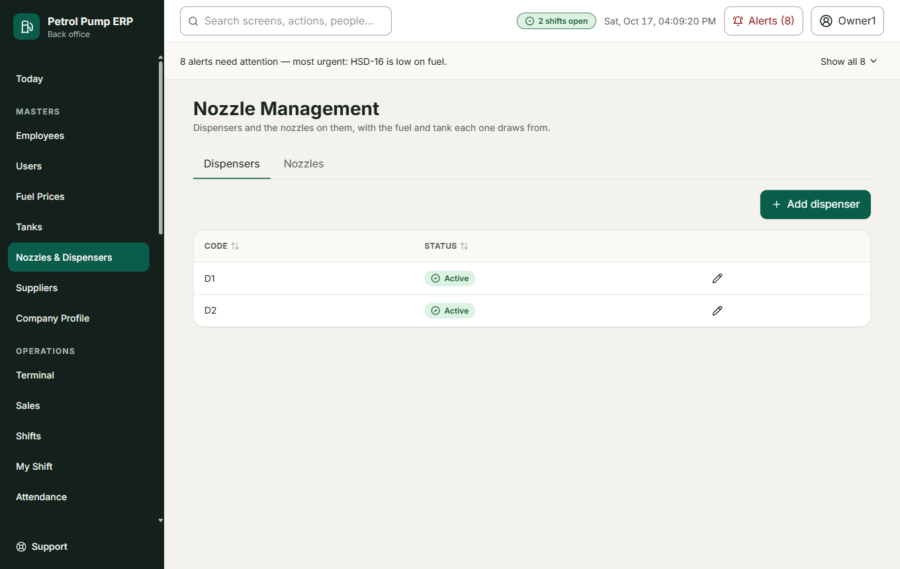

A **dispenser** is the machine on the forecourt. A **nozzle** is one of its hoses, drawing one fuel from one tank. **Add dispenser**, **Add nozzle** (code, dispenser, fuel, tank) and **Change status** (active, inactive, maintenance, with a reason). The most nozzles one dispenser can have is Owner Choice S-01 (4 unless changed).

### Suppliers

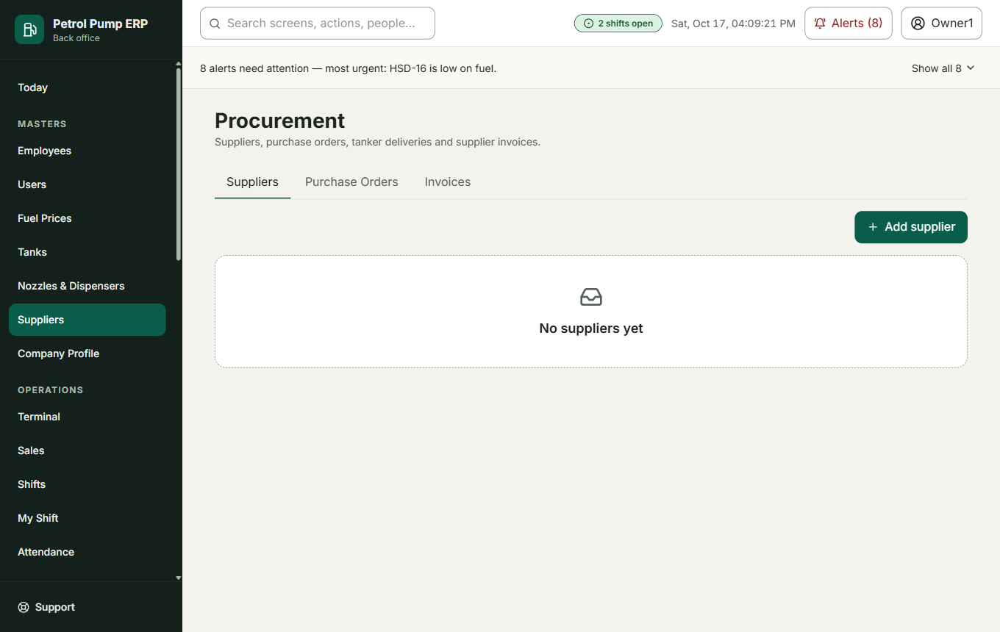

The companies you buy fuel from. **Add supplier** (name, contact person, phone, email, address, GST number). An inactive supplier cannot get new orders but stays on record.

### Company Profile

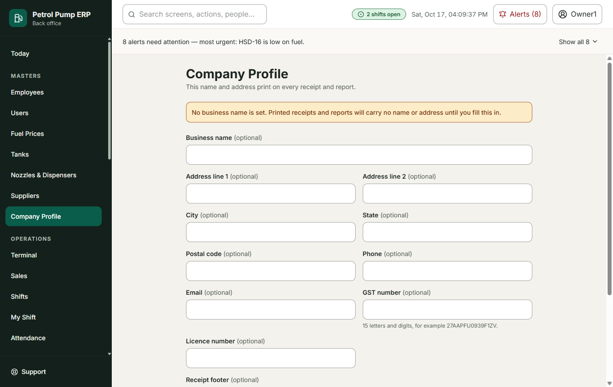

**This name and address print on every receipt and report.** Fill in the business name, address, phone, email, GST number, licence number and the line at the bottom of every receipt. **Save** applies it everywhere.

---

## Part 5. Operations (the daily work)

### Terminal

**For the office desk.** Used one sale at a time, and only for sales that are **not** collected by the attendants themselves.

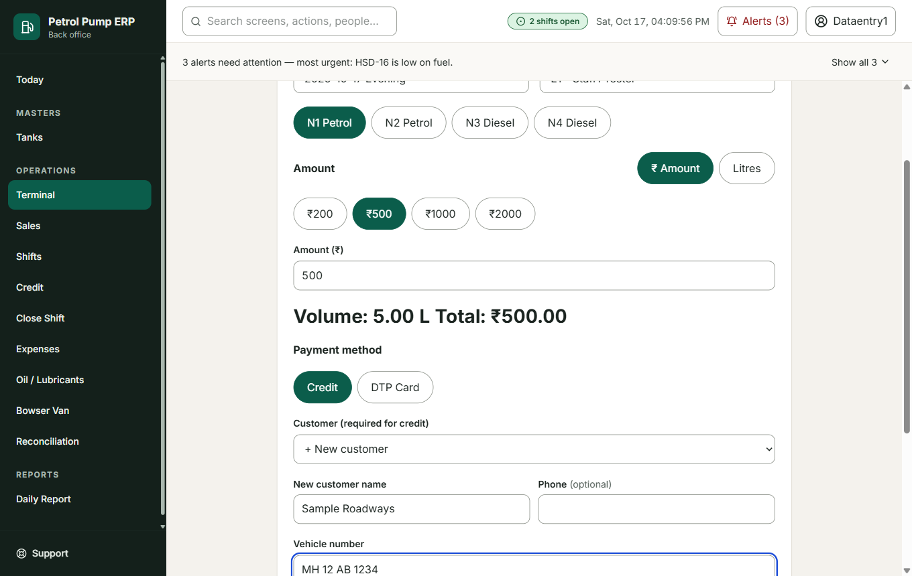

* **Credit:** a customer who pays later. Choose the customer, or **+ New customer** and type the name (and phone). The program checks if that person already exists (by phone first, then name) and uses the existing one. A new customer is created with a **credit limit of ₹0** and the status "owner to approve". Their **first bill goes through**; the next credit bill is **blocked until an owner approves them and sets a limit**. An owner can still allow it for one bill by typing their password and a reason. The owner sees an alert asking them to approve the new customer.
* **DTP Card:** the oil company's fleet card. Entered one sale at a time.
* **Vehicle number** is required on every sale. It is saved in capitals with no spaces ("mh 12 ab 1234" becomes MH12AB1234) and shows on the receipt, the customer's statement and the daily report.
* **Amount or litres**, **Shift**, **Attendant** and **Nozzle** are picked at the top.

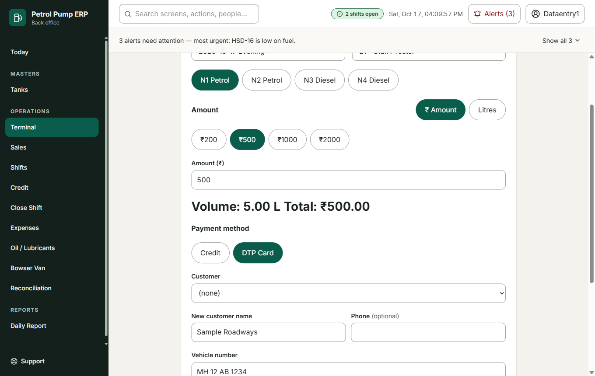

Cash, UPI and card are not typed here: attendants collect those themselves and hand them in as totals at **Close Shift**.

**What it changes:** creates the sale, takes the litres out of the tank, adds the amount to the customer's balance (credit) or to the shift's DTP total (DTP Card), and prints a receipt.

**Example:** a tanker driver from Sample Roadways fills 60 litres of diesel. At the desk you choose Credit, **+ New customer** "Sample Roadways", vehicle MH12AB1234, amount ₹5,000, **Complete sale**. A receipt shows. The owner is told to approve Sample Roadways.

### Sales

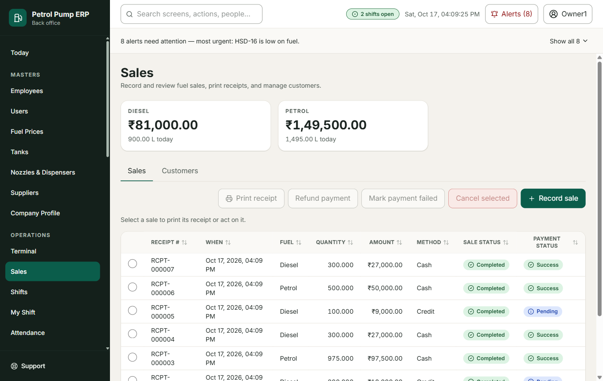

The list of every sale, today's revenue by fuel, and the customers. **Record sale** is the older sale form. Select sales to **Cancel selected** (the fuel goes back into the tank and the cancellation is recorded) or fix a payment (**Mark payment failed**, **Refund payment**). **Add customer** adds a name, phone, email and address.

### Shifts

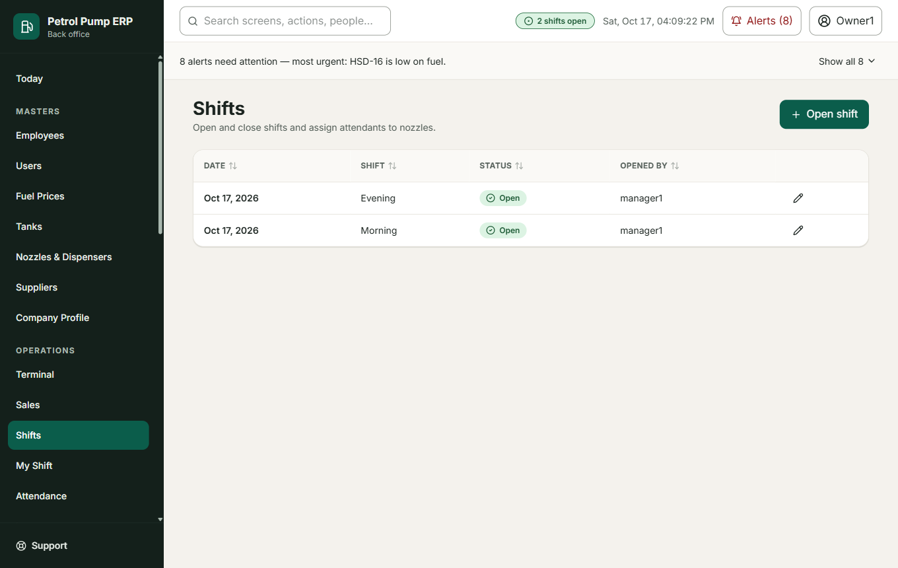

**Open shift** (date and label such as Morning), **Assign nozzle** (employee, nozzle and the **opening meter**), **Complete assignment** (the **closing meter**, the litres poured out for testing and put back, and litres used by the pump's own vehicles), **Close shift**, and **Reopen shift** (with a reason). A shift cannot close while a nozzle is still assigned.

### My Shift

An attendant's own view of their current nozzle.

### Close Shift

**The data-entry person types this after every shift.**

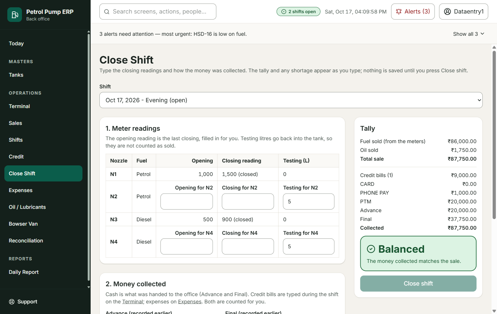

* **Nozzle readings:** the closing meter of each nozzle (the opening is the last closing). The usual testing litres are filled in.
* **Collected:** the money handed in by source: **Card, DTP Card, Phone Pay, PTM, Other**, plus **Advance** and **Final** (the cash handed over to the owner during and at the end of the shift).
* **DTP Card is not typed.** It is shown read-only as the total of that shift's Terminal DTP sales, with how many there were. This stops the same money being counted twice.
* The **Tally** on the right updates as you type: the shift's total sale against everything collected. **Balanced** (green), **Short** or **Excess**, with the amount. Nothing is saved until you press **Close shift**.

**What it changes:** saves the readings and the collected totals together (all or nothing), **closes the shift**, takes the sold litres out of the tanks, and starts the review chain at **Entered**. If anything is wrong nothing is saved.

**Example:** the nozzles show ₹50,000 sold. Collected: Card ₹10,000, Phone Pay ₹5,000, Advance ₹20,000, Final ₹14,000 = ₹49,000. The tally says **Short ₹1,000**. Find the ₹1,000 before pressing Close shift, or close and deal with the shortage on Reconciliation.

### Shift Close (older screen) and Card, DTP and Phone Pay totals

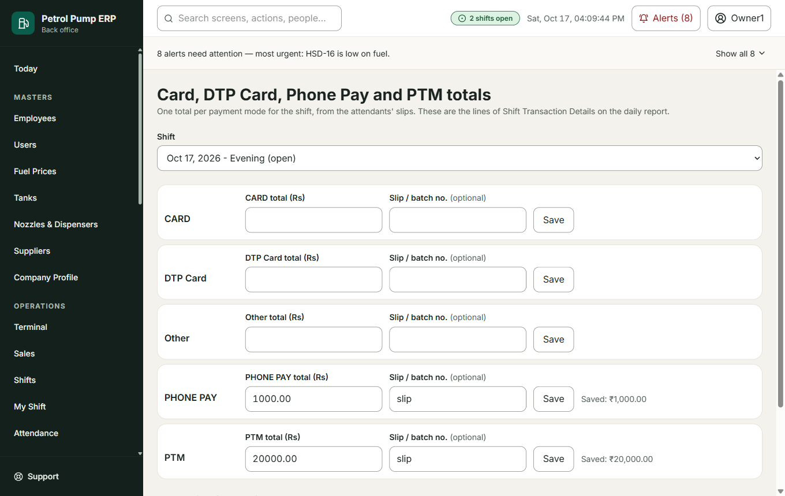

The earlier two-step way of doing Close Shift. **Card / Phone Pay totals** records one total per payment mode from the attendants' slips. DTP Card here is the Terminal's sum and is not typed. **Internal fuel use** records fuel the pump used for its own vehicles or generator.

### Attendance and Leave

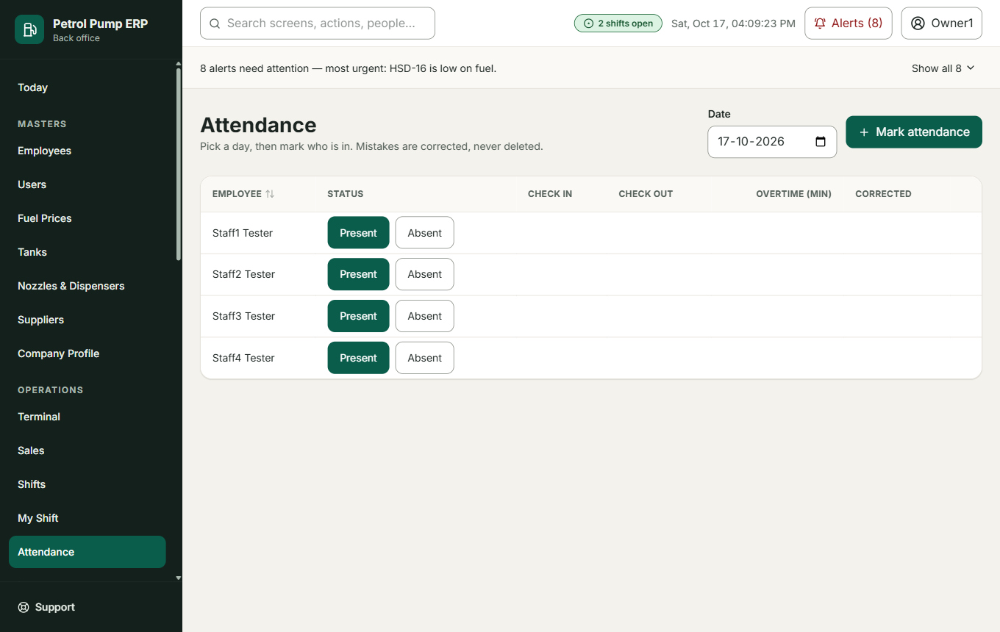

**Attendance:** pick a day, then **Present** or **Absent** for each person (with shift and overtime minutes). A mistake is corrected with a reason, never deleted. **Leave:** **Request leave** (employee, from, to, reason), then **Approve**, **Reject** or **Cancel**. Approved days are written into attendance.

### Credit

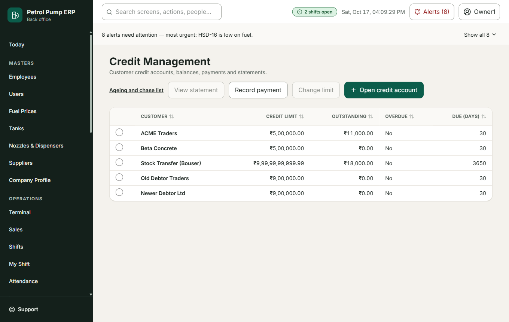

Customers who buy now and pay later. **Add new customer** opens a credit account with a **credit limit** and **payment due days**. For each customer you can **View statement**, **Record payment**, **Change limit** (with a reason).

**Record payment** is counted against the **oldest bill first**.

#### One customer

Shows what they owe now, the limit, how much is still available, the average days they take to pay, the oldest unpaid bill and a bill-by-bill list. **Log follow-up** records a call ("promised ₹5,000 on Friday") and later **Kept** or **Broken**. **Approve credit for this customer** is for owners (see Terminal). Each bill can have a vehicle number and slip number added.

**What it changes:** the customer's balance. A payment never edits an old bill; it is applied against bills.

### Credit Ageing

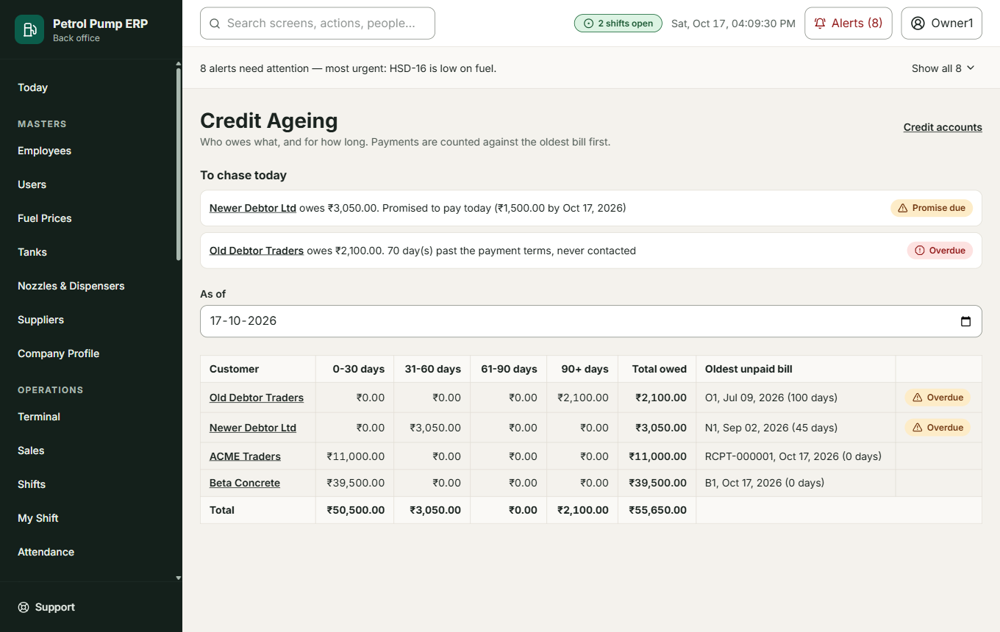

Who owes what, and for how long: columns for bills 0 to 30 days old, 31 to 60, 61 to 90 and over 90 days. Payments are counted against the oldest bill first.

### Expenses

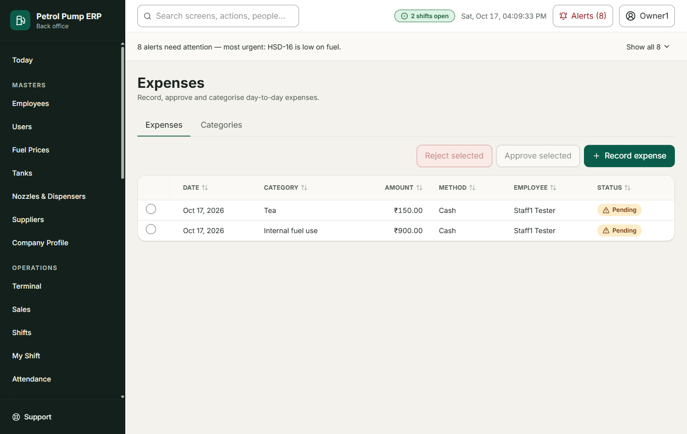

**Record expense** (category, amount, payment method, employee, shift, receipt reference, description). A manager or owner **Approve selected** or **Reject selected**. Until approved an expense is still counted in the shift tally. **Add category** adds a type of expense.

### Oil and Lubricants

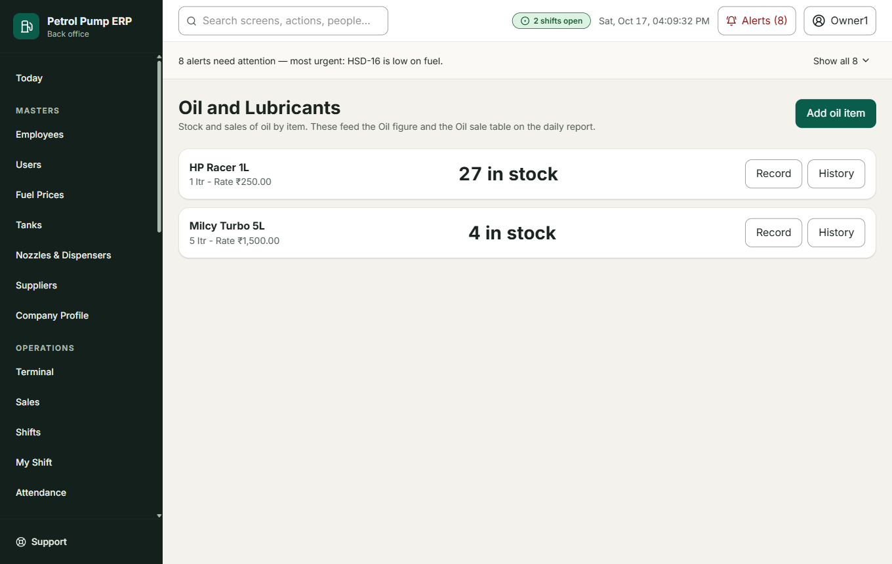

Stock and sales of oil by item (for example engine oil). **Add oil item** (name, pack size, selling rate), then **Record** what happened: stock in, sold in a shift, with the quantity and rate. These feed the Oil lines of the daily report.

### Bowser Van

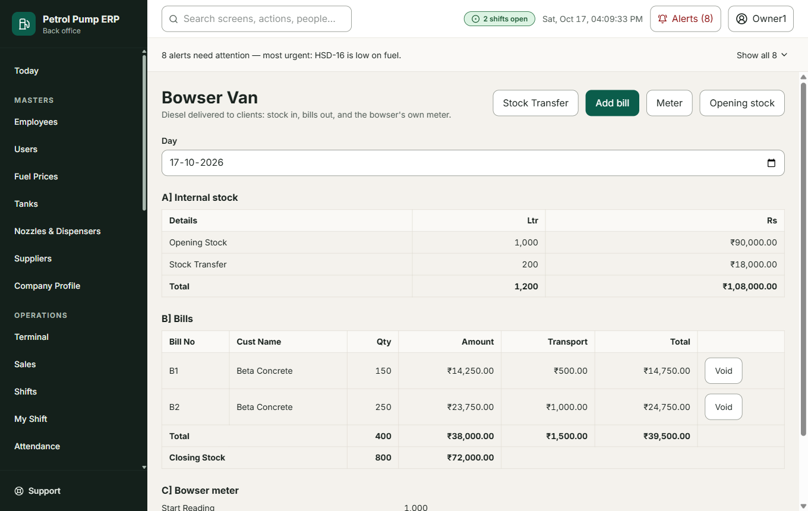

The pump's own delivery van that takes diesel to clients. **Opening stock**, **Stock Transfer** (diesel moved from a tank into the van), **Add bill** (bill number, customer, litres, rate, transport, vehicle, slip), **Meter** (start, testing and end reading). **Void** cancels a bill with a reason (it stays visible).

### Reconciliation

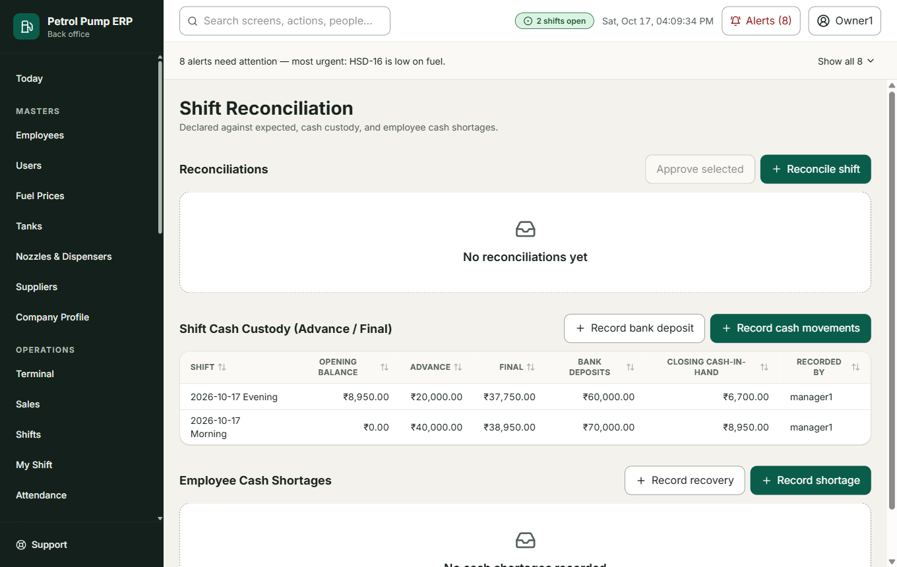

**Reconcile shift** compares what was **declared** with what was **expected** for each payment mode. A large difference needs approval (**Approve**). **Record cash movements** records Advance and Final. **Record bank deposit** records money taken to the bank. **Record shortage** books a missing amount against the employee responsible; **Record recovery** records the money they paid back (it lands in the cash book of the shift they repaid in).

**What it changes:** a cash shortage becomes an expense so the books balance, and a debt the employee owes until repaid.

### Bank Matching

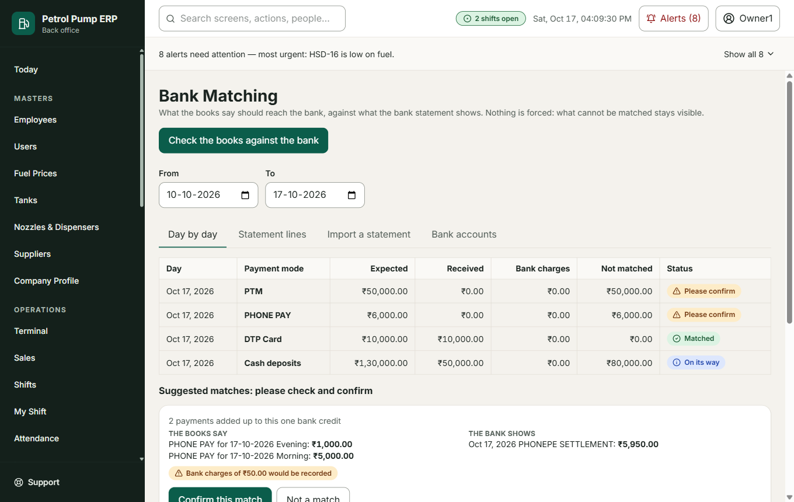

Compares what the books say should have reached the bank with what the **bank statement** shows. **Add account**, import a statement file (choose the columns once and **Save layout**), then each day shows **Expected against received**. **Confirm this match**, **Match by hand**, **Not a match**, **Mark as not the pump** (a deposit that is not pump money). **Undo match** reverses a decision. Nothing is forced: what cannot be matched stays visible.

### Payroll

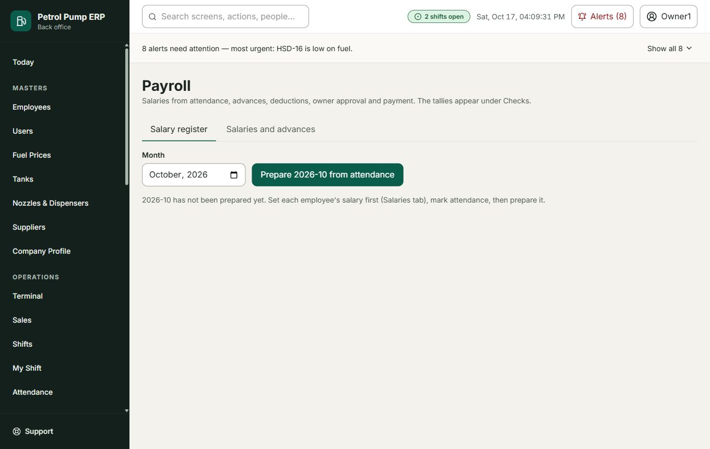

**Set salary** for each person. **Record advance** money given early. Each month: prepare the register (from attendance), check **Deductions** (advance recovered, cash shortage recovered, other), then an owner **Approve this month**, then **Mark paid** (by cash or bank). Nothing is paid before the owner approves.

### Procurement

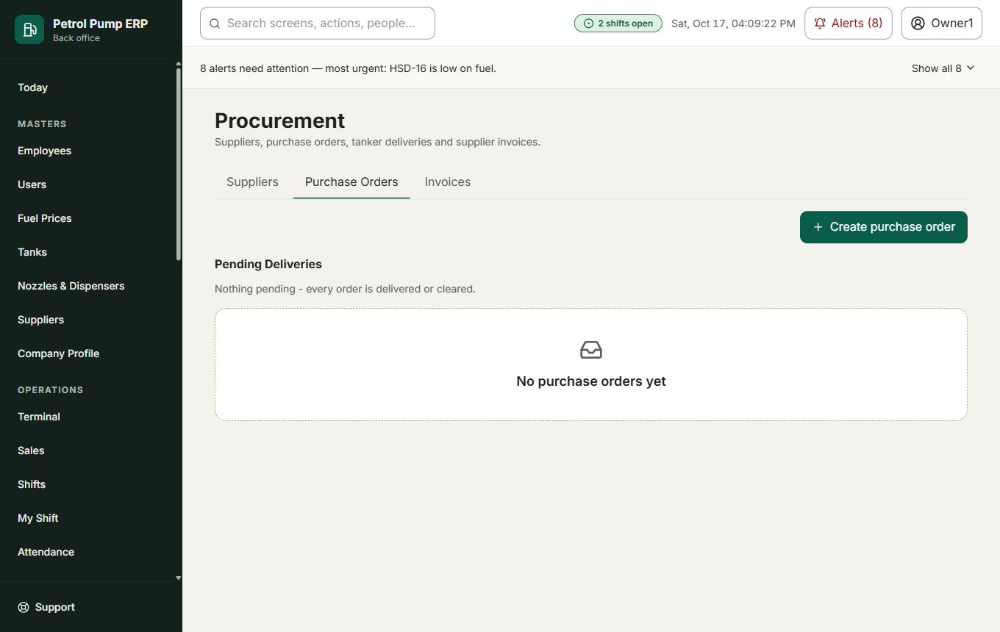

The full paperwork for fuel you buy: **Create purchase order** (supplier, fuel, quantity, rate), then when the tanker comes **Record delivery arrival** (tanker number, driver), **Verify documents**, **Verify quality**, **Record pre-dip reading** (the tank before), **Record post-dip and unload**. The delivery adds the fuel to the tank. **Record invoice** and **Record payment** track what is owed to the supplier. A delivery can be **rejected** with a reason.

### Daily Report

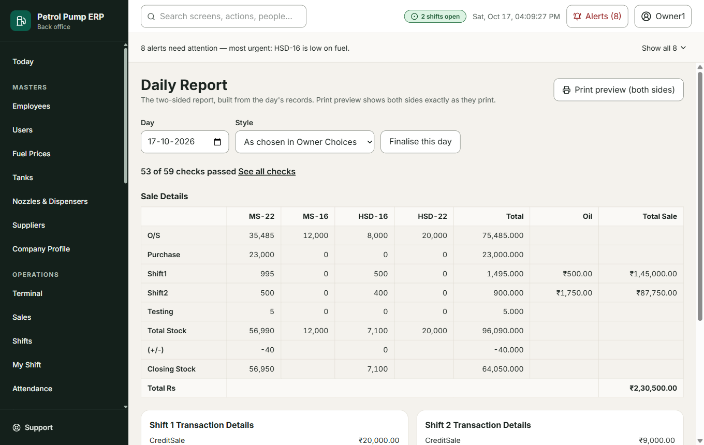

The owners' two-sided report for a day: tanks, nozzle meters, the money by payment mode, credit bills, expenses, oil and the bowser. Pick the **Day** and the **Style**: **Classic** is the exact copy of the paper report; **Plus** adds the checks, the bank status and extra lines. **Print preview** shows both sides exactly as they print; you can print or save as PDF. **Finalise this day** freezes the report and records a fingerprint of it; if figures change later you can see that the printed copy is out of date.

---

## Part 6. Reports and insight

### Reports

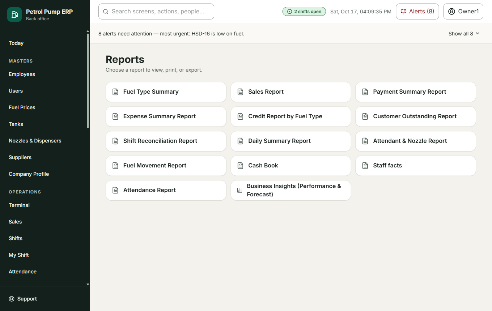

A hub of reports: fuel summary, sales, payment summary, expenses, credit, customer outstanding, reconciliation, daily summary, attendant and nozzle report, fuel movement, cash book, attendance. Each can be filtered (from, to, employee, nozzle), previewed, printed and exported to **PDF** and **Excel**. You see only the reports your role may see.

### Business Insights

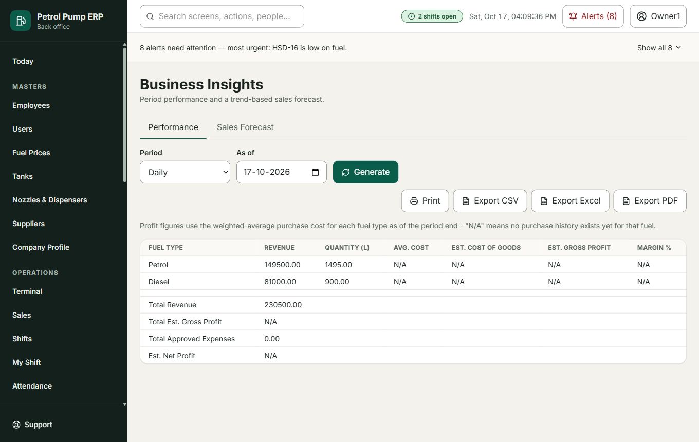

Period performance (day, week, month) and a simple, trend-based forecast of sales. **Generate** builds it. It is a guide, not a promise.

### Audit Log

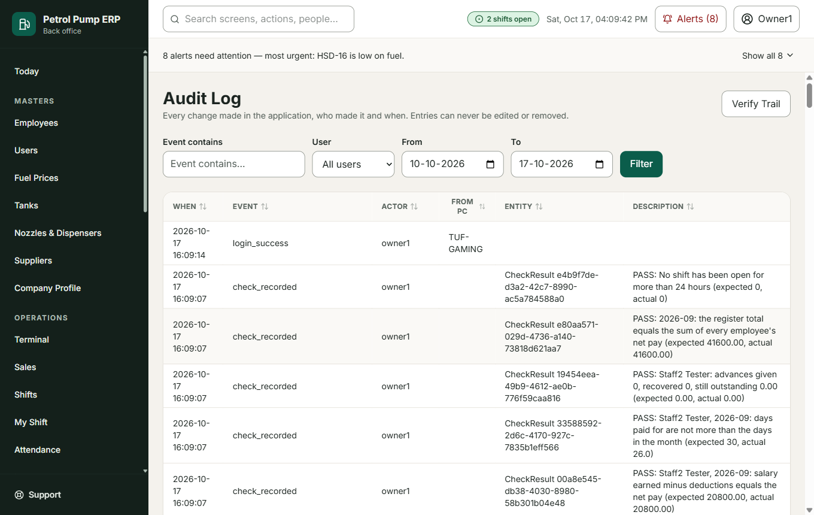

Every change made in the program, who made it and when. **Filter** by event, user and dates. **Verify Trail** proves nobody has tampered with the log (each entry is chained to the one before it). Entries can never be edited or removed.

---

## Part 7. Settings (owners and admins)

### Owner Choices

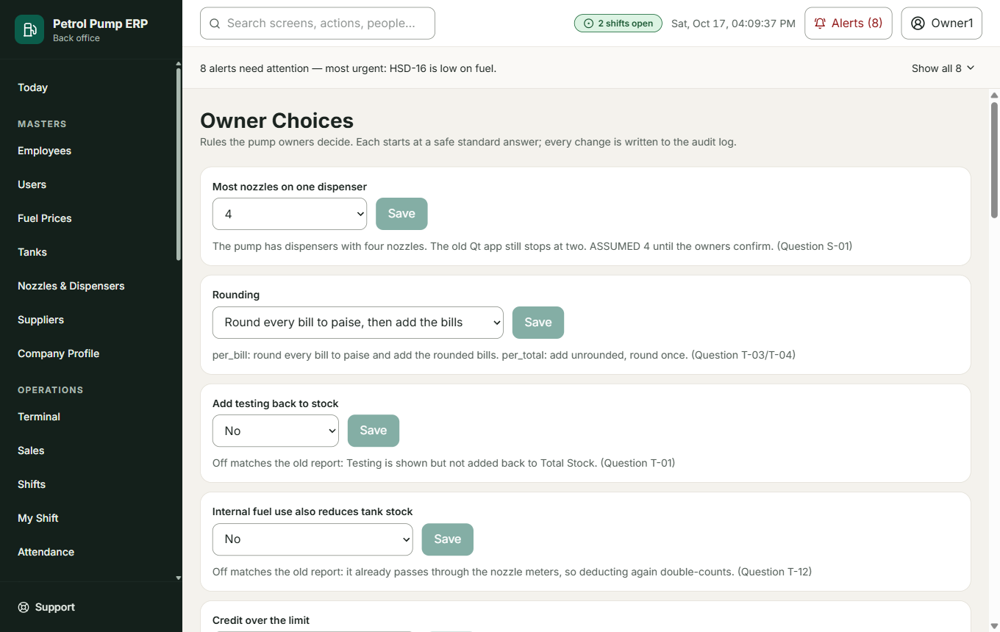

The rules the owners decide, each with an ID, a safe starting answer and a short explanation. Every change is written to the audit log. See the appendix for the list.

### Backups

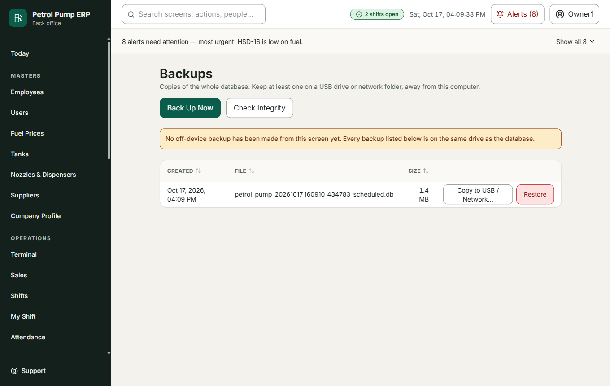

Copies of the whole database. **Back Up Now**, **Check Integrity**, **Copy to USB / Network** (keep at least one copy away from this computer) and **Restore** (needs a reason; the current data is backed up first). A copy of the data on a stick is the only protection if the computer is lost.

### Devices (Main PC only)

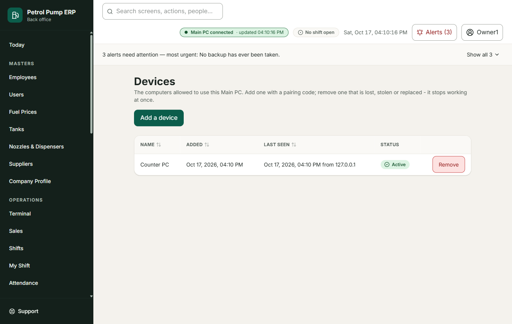

The computers allowed to use this Main PC. **Add a device** shows a one-time pairing code. **Remove** (with a reason) stops a lost or replaced computer at once. See the Network Setup Guide.

### System Health

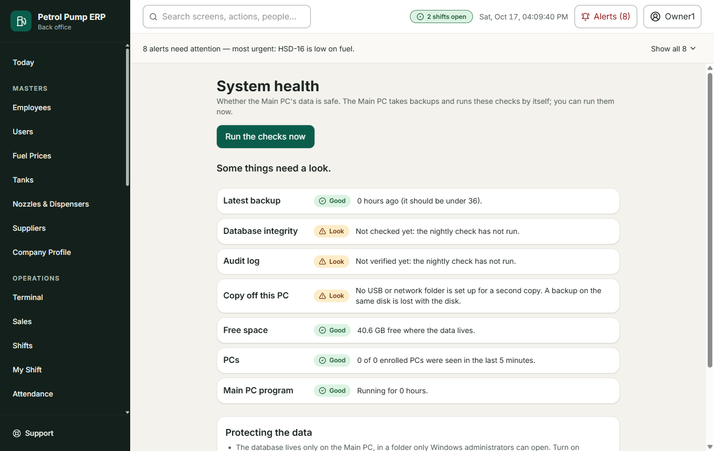

Whether the Main PC's data is safe: when the last backup was, whether the database passes its own check, the audit log chain. **Run the checks now**. **Save passphrase** protects the copies sent to a USB stick or network folder.

### Email Summary

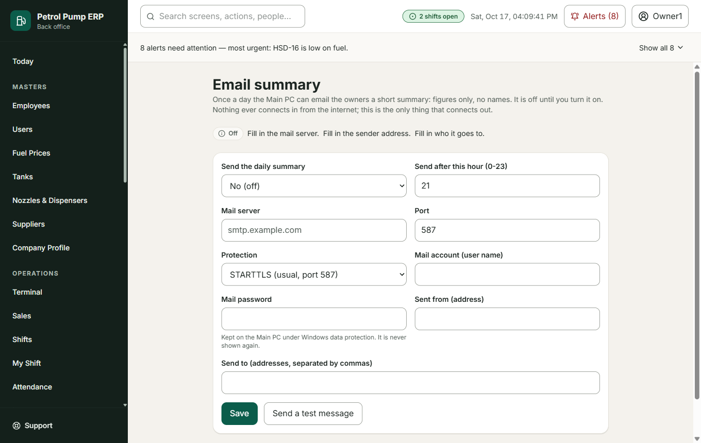

Optional. Once a day the Main PC can email the owners a short summary of figures (no names). Off until switched on. **Send a test message** checks the settings. This is the only thing in the program that connects outward.

### Support

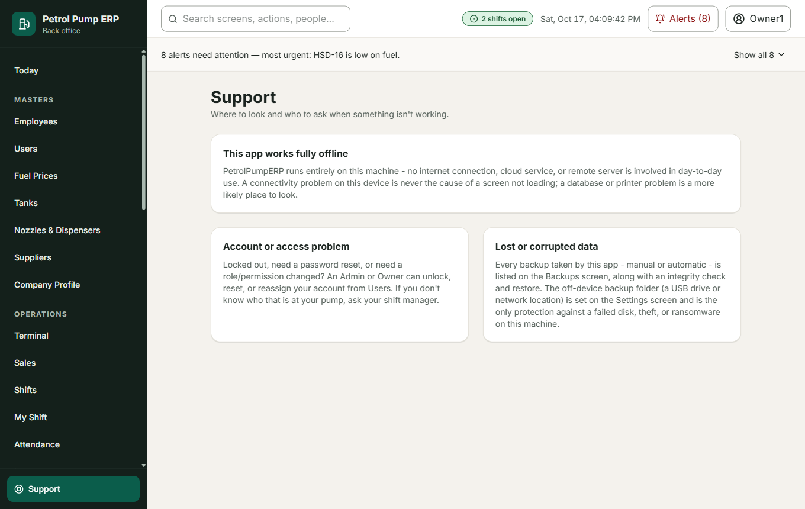

Where to look and who to ask when something does not work.

---

## Glossary

| Word | Meaning |
|---|---|
| **MS** | Motor Spirit: petrol |
| **HSD** | High Speed Diesel: diesel |
| **Dip** | Measuring how deep the fuel is in a tank with a graduated stick. The reading is in centimetres; a **dip chart** turns centimetres into litres |
| **Book stock** | What the program says is in the tank: what came in minus what went out |
| **Physical stock** | What you actually measure in the tank |
| **Variance** | Physical minus book. A little is normal (temperature, evaporation); a lot needs explaining |
| **Testing** | Each nozzle pours a few litres into a measure to prove it is accurate, then the fuel is poured back into the tank. The meter counted it, but it was not sold |
| **Meter / closing reading** | The counter on a nozzle. Litres sold = closing minus opening, less testing |
| **Shift** | A part of the day (Morning, Evening) worked by a team |
| **DTP Card** | The oil company's fleet card. A sale is paid by the company later, and entered one at a time at the office |
| **PTM / Phone Pay** | Mobile wallet payments (Paytm, PhonePe), collected by the attendant and handed in as a total |
| **Credit sale** | Fuel given now, paid for later by a regular customer (usually a transport company) |
| **Advance / Final** | The cash handed to the owner during the shift (Advance) and at its end (Final). In the payroll an **advance** is also money given to an employee before pay day |
| **Bowser (Bouser)** | The pump's own small tanker used to deliver diesel to customers |
| **Stock Transfer** | Diesel moved from an underground tank into the bowser |
| **Reconcile** | Compare two figures that should agree, and deal with the difference |
| **Declared / expected** | What the cashier says was collected, against what the sales say should have been |
| **Locked** | A shift the owners have closed for good. It only changes if an owner reopens it with a reason |
| **Main PC / Client PC** | The one computer that keeps all the data, and the other computers that work through it |

---

## Appendix. Owner Choices

| ID | Choice | Starts as |
|---|---|---|
| T-00 | Daily report style | Classic |
| T-01 | Add testing back to stock | Off |
| T-02 | Dip difference tolerance | 0.5 % |
| T-03/T-04 | Rounding of bills | Per bill |
| T-12 | Internal fuel use also reduces tank stock | Off |
| T-15 | Usual testing per nozzle | 5 litres |
| V-06 | Who may lock a shift | One owner may approve and lock |
| V-07 | A failing check stops a lock | Block (an owner can lock anyway with a reason) |
| V-10 | New credit customers need owner approval | Off |
| V-14 | Credit over the limit | Warn (allow with an owner override) |
| W-33 | Attendants can use the Terminal | Off |
| W-34 | New customer made at the counter | On (limit 0, first bill allowed, then owner approval) |
| S-01 | Most nozzles on one dispenser | 4 |
| H-02 | Bank date window | 4 days |
| H-09 | Bank charge tolerance | 2 % |
| U-04 | Leave, holidays and days in a month for pay | Not paid, calendar days |
| L-01 to L-03 | How often to back up, how old a backup may be, the nightly safety check | 24 h, 36 h, after 02:00 |
| L-10 to L-17 | The optional daily email | Off |

The choices **V-07, W-33, W-34 and S-01** are the program's assumptions until the owners confirm them.
